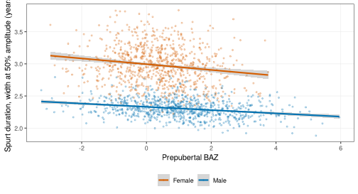

# SITAR growth curves and the pubertal growth spurt

> **About this vignette.** All data are simulated with
> [`wgh_simulate()`](https://nhanhocu.github.io/WeGrowHealthR/reference/wgh_simulate.md).
> The results show how the methods work and resemble the published
> patterns, but they are not the published findings and are not research
> results. SITAR models use at most 1,000 children each (development
> mode), the APHV bootstrap uses 10 replicates and the quantile
> bootstraps 50.

The pubertal growth spurt has a timing (age at peak height velocity,
APHV), an intensity (peak height velocity, PHV) and a duration. This
vignette shows how to estimate all three from school visits with SITAR
models, and how to relate them to prepubertal BMI. It reproduces the
analyses of three studies: the pubertal spurt by SITAR (Ho et al. 2026)
\[1\], the distribution of pubertal growth velocity (Ho 2026) \[2\] and
the duration of the spurt (Ho 2026) \[3\]. The vignette is precomputed
because SITAR models take minutes to fit.

``` r

library(WeGrowHealthR)
wgh_config("dev")     # SITAR on up to 1,000 children per model, few bootstrap replicates
#> WeGrowHealthR run mode: dev
v <- wgh_simulate(30000, seed = 2026)$visits
```

## 1. Is there enough data at each age?

Mean curves are unreliable where few children are measured.
[`wgh_age_density()`](https://nhanhocu.github.io/WeGrowHealthR/reference/wgh_age_density.md)
counts children and visits in half-year bins and reports the age at
which the number of children falls below 10% of its peak (`share`). The
package trims velocity curves at that age.

``` r

ad <- wgh_age_density(v[v$age >= 6, ])
attr(ad, "sparse_from")
#> Female   Male 
#>   18.5   18.5
```

## 2. Fitting a SITAR model

SITAR (SuperImposition by Translation And Rotation) describes every
child’s height curve as one mean curve shifted in size (`a`, cm), timing
(`b`, years, negative means earlier) and intensity (`c`, on the log
scale, positive means a faster, more intense spurt).
[`wgh_fit_sitar()`](https://nhanhocu.github.io/WeGrowHealthR/reference/wgh_fit_sitar.md)
wraps [`sitar::sitar()`](https://rdrr.io/pkg/sitar/man/sitar.html):

- `df` is the flexibility of the mean spline (4 or 5 is usual),
- `fixed` and `random` choose the effects (`"a + b + c"`, or
  `"a + b + c + d"` for the extended model),
- `age_range` the ages used and `min_visits` the visits needed per
  child,
- `max_children` limits the number of children (set by the run mode).

It never stops on a failed fit. Instead it keeps the error, so competing
models can be compared, and it retries once with one fewer degree of
freedom.

``` r

boys <- v[v$sex == "Male" & v$age >= 6 & v$age <= 18, ]
fit_m <- wgh_fit_sitar(boys, df = 5, age_range = c(6, 18))
#> SITAR fitted to a random 1000 of 3643 children (run mode "dev").
fit_m
#> <wgh_sitar> "6-18 a+b+c": 3990 visits from 1000 children, df = 5
#> Population APHV 12.03 y, PHV 10.12 cm/y
#> # A tibble: 1 x 15
#>   model    converged n_children    AIC    BIC sigma  RMSE  sd_a  sd_b   sd_c  sd_d min_velocity_tail
#>   <chr>    <lgl>          <int>  <dbl>  <dbl> <dbl> <dbl> <dbl> <dbl>  <dbl> <dbl>             <dbl>
#> 1 6-18 a+~ TRUE            1000 14992. 15087. 0.527 0.360  4.47 0.464 0.0715    NA             0.146
#> # i 3 more variables: max_re_corr <dbl>, APHV <dbl>, PHV <dbl>
```

The printout shows the number of children and visits, the population
APHV and PHV, and diagnostics: whether the fit converged, whether the
velocity curve turns negative in the tails, and the residual SD.

``` r

plot(fit_m, type = "both", line_width = 1.2)
```


[`plot()`](https://rdrr.io/r/graphics/plot.default.html) takes
`type = "velocity"`, `"height"` or `"both"`, `trim` and `show_data`,
plus the shared display options.

### Checking the model

Two checks matter before using the estimates.
[`wgh_check_identifiable()`](https://nhanhocu.github.io/WeGrowHealthR/reference/wgh_check_identifiable.md)
flags random effects that are almost perfectly correlated, a sign that
the model cannot separate them.
[`wgh_sitar_select()`](https://nhanhocu.github.io/WeGrowHealthR/reference/wgh_sitar_select.md)
compares candidate specifications by BIC, a positive velocity in the
tails and stable APHV and PHV, and picks one by a stated rule (the
procedure used for girls in \[1\]).

``` r

wgh_check_identifiable(fit_m)
#> $ok
#> [1] TRUE
#> 
#> $max_abs_corr
#> [1] 0.4927345
#> 
#> $pair
#> [1] "c-b"
#> 
#> $reason
#> [1] "OK: random effects c-b correlated at r = -0.493"
girls <- v[v$sex == "Female" & v$age >= 6 & v$age <= 16, ]
sel <- wgh_sitar_select(girls)
#> SITAR fitted to a random 1000 of 2938 children (run mode "dev").
#> SITAR fitted to a random 1000 of 2757 children (run mode "dev").
#> SITAR fitted to a random 1000 of 2938 children (run mode "dev").
sel$table
#> # A tibble: 3 x 21
#>   model converged n_children    AIC    BIC  sigma   RMSE  sd_a   sd_b   sd_c   sd_d
#>   <chr> <lgl>          <int>  <dbl>  <dbl>  <dbl>  <dbl> <dbl>  <dbl>  <dbl>  <dbl>
#> 1 F1    TRUE            1000 15457. 15545.  0.519  0.339  5.23  0.763  0.103 NA    
#> 2 F2    FALSE             NA    NA     NA  NA     NA     NA    NA     NA     NA    
#> 3 F3    TRUE            1000 15428. 15548.  0.505  4.19   7.08  1.35   0.144  0.494
#> # i 10 more variables: min_velocity_tail <dbl>, max_re_corr <dbl>, APHV <dbl>, PHV <dbl>,
#> #   identifiable <lgl>, plausible_tail <lgl>, good_fit <lgl>, acceptable <lgl>, why_not <chr>,
#> #   stable <lgl>
sel$selected
#> [1] "F1"
sel$reason
#> [1] "No candidate met all criteria (F1: velocity falls below the tolerance in the tail; F2: did not converge; F3: residual error more than twice the best model). The first model is kept and its mean curve should be displayed only within the age range with adequate data."
fit_f <- sel$fits[[sel$selected]]
```

Read `sel$reason` before using the selected model. Here, with a
subsample of 1,000 girls in development mode, no candidate meets every
criterion, so the function keeps the first model and says why each
candidate failed. With the full cohort (`wgh_config("publication")`)
more candidates may converge. When none is acceptable, show the mean
curve only over the ages with enough data and report the reason with the
results.

## 3. APHV and PHV with honest intervals

[`wgh_aphv()`](https://nhanhocu.github.io/WeGrowHealthR/reference/wgh_aphv.md)
gives the population APHV and PHV from the mean curve.
[`wgh_sitar_ci()`](https://nhanhocu.github.io/WeGrowHealthR/reference/wgh_sitar_ci.md)
adds intervals. The default `method = "bootstrap"` resamples children
and refits the model `B` times, which carries all the uncertainty of the
curve. `method = "legacy"` reproduces the interval of the original
analysis code (the estimate plus or minus 1.96 times the SD of
individual APHV over the square root of n). It is not a bootstrap: it
treats the spread of individual timing as sampling error, so its width
has no clear meaning, and it is kept only to match published numbers.

``` r

ci_m <- wgh_sitar_ci(fit_m, B = 10)
ci_m
#> # A tibble: 1 x 9
#>   method             aphv aphv_lower aphv_upper   phv phv_lower phv_upper n_children replicates
#>   <chr>             <dbl>      <dbl>      <dbl> <dbl>     <dbl>     <dbl>      <int>      <int>
#> 1 cluster bootstrap  12.0       12.0       12.1  10.1      10.0      10.2       1000         10
wgh_sitar_ci(fit_m, method = "legacy")
#> # A tibble: 1 x 9
#>   method                  aphv aphv_lower aphv_upper   phv phv_lower phv_upper n_children replicates
#>   <chr>                  <dbl>      <dbl>      <dbl> <dbl>     <dbl>     <dbl>      <int>      <int>
#> 1 legacy (not a bootstr~  12.0       12.0       12.1  10.1      10.1      10.2       1000         NA
```

With 1,000 children the population curve is estimated precisely, so both
intervals are narrow here. With `B = 10` the bootstrap interval is
rough. Use `B = 200` or more for a paper (`wgh_config("publication")`
does that).

## 4. Individual timing and intensity

[`wgh_sitar_effects()`](https://nhanhocu.github.io/WeGrowHealthR/reference/wgh_sitar_effects.md)
returns one row per child with the random effects and the child’s own
APHV and PHV. The individual APHV uses the exact SITAR formula, not an
approximation. `early_timing` flags children whose timing is earlier
than the population (`b < early_cut`), and `faster_tempo` children with
a more intense spurt (`c > 0`).

``` r

eff_m <- wgh_sitar_effects(fit_m)
eff_f <- wgh_sitar_effects(fit_f)
head(eff_m)
#> # A tibble: 6 x 10
#>   id           a       b       c  aphv   phv early_timing faster_tempo aphv_population sex  
#>   <chr>    <dbl>   <dbl>   <dbl> <dbl> <dbl> <lgl>        <lgl>                  <dbl> <fct>
#> 1 C000026  4.03  -0.181   0.0765  11.8 10.9  TRUE         TRUE                    12.0 Male 
#> 2 C000036 -0.773  0.183  -0.0597  12.3  9.53 FALSE        FALSE                   12.0 Male 
#> 3 C000044  2.16  -0.286   0.0900  11.6 11.1  TRUE         TRUE                    12.0 Male 
#> 4 C000049  5.20  -0.395   0.0615  11.6 10.8  TRUE         TRUE                    12.0 Male 
#> 5 C000118 -0.985 -0.671   0.0391  11.3 10.5  TRUE         TRUE                    12.0 Male 
#> 6 C000143 -2.93   0.0406  0.0449  12.0 10.6  FALSE        TRUE                    12.0 Male
summary(eff_m$aphv)
#>    Min. 1st Qu.  Median    Mean 3rd Qu.    Max. 
#>   10.45   11.78   12.03   12.03   12.30   13.53
summary(eff_f$aphv)
#>    Min. 1st Qu.  Median    Mean 3rd Qu.    Max. 
#>   7.346   8.492   9.046   9.104   9.634  11.710
```

Girls reach their peak years before boys, the most consistent finding of
growth studies, and individual APHV varies around the population value,
more in girls than in boys.

**Next step.** Join these effects to other data by `id`, for example to
ask whether prepubertal BMI predicts earlier timing (section 7).

## 5. Velocity curves of individual children

[`wgh_velocity_panel()`](https://nhanhocu.github.io/WeGrowHealthR/reference/wgh_velocity_panel.md)
evaluates each child’s velocity curve on a grid, either by age
(`time = "age"`) or by years from the child’s own APHV
(`time = "aphv"`). `observed_only = TRUE` keeps only the part of each
curve covered by the child’s visits, so no child is extrapolated.

``` r

pan <- wgh_velocity_panel(fit_m, time = "aphv", grid = seq(-4, 4, by = 0.05), observed_only = FALSE)
head(pan)
#> # A tibble: 6 x 5
#>   id        age  time height velocity
#>   <chr>   <dbl> <dbl>  <dbl>    <dbl>
#> 1 C000026  7.76 -4      130.     5.71
#> 2 C000026  7.81 -3.95   130.     5.70
#> 3 C000026  7.86 -3.9    131.     5.68
#> 4 C000026  7.91 -3.85   131.     5.66
#> 5 C000026  7.96 -3.8    131.     5.65
#> 6 C000026  8.01 -3.75   131.     5.63
```

## 6. Duration of the spurt

[`wgh_curve_features()`](https://nhanhocu.github.io/WeGrowHealthR/reference/wgh_curve_features.md)
measures the width of each child’s velocity peak. The default
(`reference = "takeoff"`) measures the width at 25%, 50% and 75% of the
spurt amplitude, that is, the rise from the take-off velocity to the
peak. Older code measured the width at a fraction of PHV
(`reference = "zero"`), but the velocity of most children never falls to
half of PHV before the data start, so that width is left-censored for
most of them. The package reports censoring so this cannot go unnoticed.

``` r

cf <- wgh_curve_features(pan)
summary(cf$width_p50)
#>    Min. 1st Qu.  Median    Mean 3rd Qu.    Max. 
#>   1.883   2.218   2.303   2.308   2.393   2.811
pan_f <- wgh_velocity_panel(fit_f, time = "aphv", grid = seq(-4, 4, by = 0.05), observed_only = FALSE)
censored <- function(p) c(amplitude = mean(wgh_curve_features(p)$censored_left_p50),
  fraction_of_phv = mean(wgh_curve_features(p, thresholds = 0.5, reference = "zero")$censored_left_p50))
rbind(boys = censored(pan), girls = censored(pan_f))
#>       amplitude fraction_of_phv
#> boys          0               0
#> girls         0               1
```

`width_p50` is the width of the spurt in years at half its amplitude.
The second table gives the share of children whose width cannot be
measured because the velocity curve does not fall far enough before the
data start. Girls start their spurt early, so with the legacy definition
the width is censored for most of them, while the amplitude definition
measures every child.

## 7. Does prepubertal BMI change the spurt?

The prepubertal exposure is the earliest BAZ from 5 years at or before
11 years in boys and 9 years in girls (see
[`vignette("trajectories")`](https://nhanhocu.github.io/WeGrowHealthR/articles/trajectories.md)).

``` r

base <- wgh_index_exposure(v, "baz", name = "pre")
base <- base[!duplicated(base$id), c("id", "pre_value")]
names(base)[2] <- "baz_pre"
e <- merge(eff_m, base, by = "id")
summary(lm(b ~ baz_pre, data = e))$coefficients
#>                Estimate  Std. Error    t value     Pr(>|t|)
#> (Intercept)  0.09209288 0.015171065   6.070298 1.937841e-09
#> baz_pre     -0.10053821 0.008473308 -11.865285 4.094392e-30
```

A negative slope means higher prepubertal BMI goes with earlier timing.

The second study asked whether the association is the same across the
distribution.
[`wgh_scalar_quantiles()`](https://nhanhocu.github.io/WeGrowHealthR/reference/wgh_scalar_quantiles.md)
fits quantile regressions of a child-level outcome with a bootstrap over
children, and reports the OLS estimate alongside:

``` r

wgh_scalar_quantiles(e, b ~ baz_pre, "baz_pre", taus = c(0.1, 0.25, 0.5, 0.75, 0.9), B = 50)
#> # A tibble: 6 x 5
#>   model        tau estimate   lower   upper
#>   <chr>      <dbl>    <dbl>   <dbl>   <dbl>
#> 1 quantile    0.1   -0.110  -0.138  -0.0870
#> 2 quantile    0.25  -0.108  -0.133  -0.0890
#> 3 quantile    0.5   -0.0883 -0.116  -0.0701
#> 4 quantile    0.75  -0.0860 -0.0988 -0.0557
#> 5 quantile    0.9   -0.0764 -0.112  -0.0625
#> 6 OLS (mean) NA     -0.101  -0.117  -0.0839
```

[`wgh_mediation()`](https://nhanhocu.github.io/WeGrowHealthR/reference/wgh_mediation.md)
asks how much of the association of BMI with PHV passes through earlier
timing:

``` r

wgh_mediation(e, "baz_pre", "b", "phv", B = 50)
#> # A tibble: 4 x 4
#>   effect                  estimate   lower  upper
#>   <chr>                      <dbl>   <dbl>  <dbl>
#> 1 Total effect             0.108    0.0828 0.149 
#> 2 Natural direct effect   -0.00492 -0.0216 0.0348
#> 3 Natural indirect effect  0.113    0.0910 0.141 
#> 4 Proportion mediated      1.05     0.763  1.23
```

The total effect is the change in PHV per unit of prepubertal BAZ. The
natural indirect effect is the part that passes through timing `b`, and
the natural direct effect the rest. A proportion mediated near or
slightly above 1 means that essentially all of the association works
through earlier timing (a proportion above 1 occurs when the direct
effect is slightly negative).

## 8. The three studies in one call each

[`wgh_flow_pubertal_spurt()`](https://nhanhocu.github.io/WeGrowHealthR/reference/wgh_flow_pubertal_spurt.md)
runs the age-density check, the male model, the female model selection,
identifiability checks, APHV and PHV with intervals, individual effects
and the links between prepubertal anthropometry and timing. Its report
is then passed as `spurt` to the velocity and duration flows, so the
SITAR models are fitted only once.

``` r

spurt <- wgh_flow_pubertal_spurt(v)
#> SITAR fitted to a random 1000 of 3643 children (run mode "dev").
#> SITAR fitted to a random 1000 of 2938 children (run mode "dev").
spurt
#> 
#> -- Pubertal growth spurt by SITAR (Ho et al. 2026, medRxiv 2026.07.26.26358986) --
#> 
#> Tables (7): age_density, model_diagnostics, aphv_phv_population, individual_effects,
#> individual_summary, timing_models, early_timing_logistic
#> Figures (3): fig_velocity, fig_height, fig_aphv_by_bmi
#> Models: sitar_male, sitar_female
#> Diagnostics: identifiability
#> Settings: mode = dev; ci_B = 0
spurt$tables$aphv_phv_population
#> # A tibble: 2 x 10
#>   sex    method           aphv aphv_lower aphv_upper   phv phv_lower phv_upper n_children replicates
#>   <chr>  <chr>           <dbl>      <dbl>      <dbl> <dbl>     <dbl>     <dbl>      <int>      <int>
#> 1 Male   legacy (not a ~  12.0      12.0       12.1  10.1      10.1      10.2        1000         NA
#> 2 Female legacy (not a ~   9.1       9.06       9.14  7.93      7.89      7.98       1000         NA
spurt$tables$early_timing_logistic
#> # A tibble: 4 x 7
#>   sex    term    odds_ratio lower upper  p_value   auc
#>   <chr>  <chr>        <dbl> <dbl> <dbl>    <dbl> <dbl>
#> 1 Female baz_pre       1.29  1.13  1.47 1.48e- 4 0.631
#> 2 Female haz_pre       1.30  1.05  1.61 1.50e- 2 0.631
#> 3 Male   baz_pre       1.51  1.35  1.70 2.65e-12 0.781
#> 4 Male   haz_pre       2.98  2.41  3.68 3.36e-24 0.781
```

``` r

plot(spurt, "fig_velocity")
```


``` r

plot(spurt, "fig_aphv_by_bmi")
```


``` r

velocity <- wgh_flow_velocity_distribution(v, spurt = spurt)
velocity$tables$scalar_quantiles
#> # A tibble: 36 x 7
#>    sex   outcome model        tau estimate    lower    upper
#>    <chr> <chr>   <chr>      <dbl>    <dbl>    <dbl>    <dbl>
#>  1 Male  b       quantile    0.05 -0.112   -0.141   -0.0929 
#>  2 Male  b       quantile    0.25 -0.108   -0.115   -0.0981 
#>  3 Male  b       quantile    0.5  -0.0883  -0.0996  -0.0797 
#>  4 Male  b       quantile    0.75 -0.0860  -0.0852  -0.0676 
#>  5 Male  b       quantile    0.95 -0.0836  -0.129   -0.0714 
#>  6 Male  b       OLS (mean) NA    -0.101   -0.117   -0.0839 
#>  7 Male  c       quantile    0.05  0.00788  0.00385  0.0125 
#>  8 Male  c       quantile    0.25  0.00792  0.00666  0.00969
#>  9 Male  c       quantile    0.5   0.0116   0.00804  0.0130 
#> 10 Male  c       quantile    0.75  0.0106   0.00748  0.0130 
#> # i 26 more rows
duration <- wgh_flow_spurt_duration(v, spurt = spurt)
duration$tables$censoring
#> # A tibble: 4 x 4
#>   sex    definition               pct_left_censored median_width
#>   <chr>  <chr>                                <dbl>        <dbl>
#> 1 Male   amplitude (default)                      0         2.30
#> 2 Male   fraction of PHV (legacy)                 0         4.31
#> 3 Female amplitude (default)                      0         2.99
#> 4 Female fraction of PHV (legacy)               100        NA
duration$tables$duration_ols
#> # A tibble: 4 x 7
#>   sex    model                     term     estimate      lower     upper  p_value
#>   <chr>  <chr>                     <chr>       <dbl>      <dbl>     <dbl>    <dbl>
#> 1 Female unadjusted                baz_pre -0.0447   -0.0628    -0.0266   1.55e- 6
#> 2 Female adjusted_timing_intensity baz_pre -0.00104  -0.00294    0.000854 2.82e- 1
#> 3 Male   unadjusted                baz_pre -0.0254   -0.0317    -0.0190   1.59e-14
#> 4 Male   adjusted_timing_intensity baz_pre  0.000361  0.0000219  0.000700 3.72e- 2
```

``` r

plot(velocity, "fig_velocity_slopes")
```


``` r

plot(duration, "fig_duration_by_bmi", alpha = 0.4)
```



## Where to go next

- The individual SITAR effects are features for prediction
  ([`vignette("prediction")`](https://nhanhocu.github.io/WeGrowHealthR/articles/prediction.md))
  and growth phenotypes
  ([`vignette("phenotypes-states")`](https://nhanhocu.github.io/WeGrowHealthR/articles/phenotypes-states.md)).
  Size `a` is estimated from the late visits, so it must not be used to
  predict late height. The package never joins it.
- [`wgh_fpca_curves()`](https://nhanhocu.github.io/WeGrowHealthR/reference/wgh_fpca_curves.md)
  decomposes the velocity curves into their main shapes.

## References

1.  Ho NT, Nguyen QV, Dao AQ, Tran CTL, Pham AN. Pubertal growth spurt
    characteristics of Vietnamese urban schoolchildren: population and
    individual level analysis using SITAR. medRxiv. 2026.
    2026.07.26.26358986. <https://doi.org/10.64898/2026.07.26.26358986>

2.  Ho NT. Prepubertal body mass index reshapes the distribution of
    pubertal growth velocity in Vietnamese children: a SITAR-based
    quantile analysis. medRxiv. 2026. 2026.09.04.26362313.
    <https://doi.org/10.64898/2026.09.04.26362313>

3.  Ho NT. Body mass index and the duration of the pubertal growth spurt
    in Vietnamese urban children. medRxiv. 2026. 2026.09.09.26362696.
    <https://doi.org/10.64898/2026.09.09.26362696>
