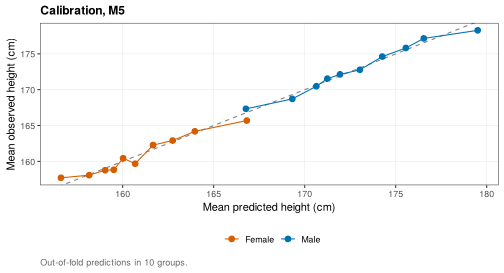
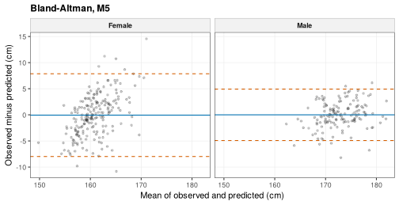

# Predicting late-adolescent height and explaining predictions

> **About this vignette.** All data are simulated with
> [`wgh_simulate()`](https://nhanhocu.github.io/WeGrowHealthR/reference/wgh_simulate.md).
> The results show how the methods work and resemble the published
> patterns, but they are not the published findings and are not research
> results. The functions run in development mode: SITAR models use at
> most 1,000 children, the benchmark uses 5-fold cross-validation and
> the prediction cohort has a few hundred children, so model rankings
> are illustrative.

Parents and clinicians often ask how tall a child will be. A prediction
is useful only if it is accurate for new children, if it comes with an
honest statement of uncertainty, and if one can see why the model
predicts what it does. This vignette walks through all three,
reproducing two studies of the research program:

- predicting late-adolescent height from prepubertal growth (Ho 2026)
  \[1\], and
- explaining individual growth predictions across the growth
  distribution (Ho 2026) \[2\].

The steps are: build a cohort of features and outcomes, compare models
on the same cross-validation folds, check calibration and agreement,
attach prediction intervals, show a prediction for one child, explain
it, and finally run the flows. The vignette is precomputed.

Prediction needs children measured both before puberty and in late
adolescence, so this vignette uses a simulated cohort followed for 14
school years with little dropout (see
[`vignette("simulated-data")`](https://nhanhocu.github.io/WeGrowHealthR/articles/simulated-data.md)
for the settings).

``` r

library(WeGrowHealthR)
wgh_config("dev")
#> WeGrowHealthR run mode: dev
v <- wgh_simulate(8000, seed = 7, years = 2012:2025, missing_years = integer(),
                  dropout = c(intercept = -4, age = 0), entry_first_prob = 0.9)$visits
```

## 1. What is predicted from what

The question is: from what we know about a child before puberty, how
tall will the child be in late adolescence?
[`wgh_prediction_cohort()`](https://nhanhocu.github.io/WeGrowHealthR/reference/wgh_prediction_cohort.md)
builds one row per child:

- the **baseline** is the earliest visit at or before a prepubertal
  cutoff (`cutoff`, 11 years in boys and 9 years in girls, in completed
  years),
- the **features** come only from visits up to the cutoff: baseline
  height, HAZ and BAZ, their categories, short- and long-term height
  velocity, the yearly slopes of BAZ and HAZ, a BMI trajectory class and
  birth year,
- the **outcome** `height_late` is the median height in a
  late-adolescent window (`outcome_window`, 16 to 18 years in boys and
  14 to 16 in girls).

A check stops the function if any baseline falls inside the outcome
window, so the outcome can never leak into the features.

``` r

pc <- wgh_prediction_cohort(v)
attr(pc, "attrition")
#> # A tibble: 6 x 3
#>   step                         children   pct
#>   <chr>                           <int> <dbl>
#> 1 All children                     5664  NA  
#> 2 With a prepubertal visit         3963  NA  
#> 3 With an outcome-window visit      358  NA  
#> 4 Retained, Site1                    NA   5.9
#> 5 Retained, Site2                    NA   7.4
#> 6 Retained, Site3                    NA   5.8
table(pc$sex)
#> 
#>   Male Female 
#>    147    211
head(pc[, c("id", "sex", "age_base", "height_base", "haz_base", "baz_base", "vel_short", "baz_slope", "height_late")])
#> # A tibble: 6 x 9
#>   id      sex    age_base height_base haz_base baz_base vel_short baz_slope height_late
#>   <chr>   <fct>     <dbl>       <dbl>    <dbl>    <dbl>     <dbl>     <dbl>       <dbl>
#> 1 C000001 Female     8.45        138.    1.51     1.78       8.01    0.199         164.
#> 2 C000028 Male      10.7         140.   -0.152    0.656     NA      NA             173 
#> 3 C000092 Male      10.5         143.    0.318    0.158      4.28   -0.617         177.
#> 4 C000096 Female     7.09        127.    0.992    0.985      6.61    0.0514        160.
#> 5 C000100 Male       9.66        130    -0.964    2.74       5.72   -0.351         168.
#> 6 C000127 Female     7.84        127.    0.218    2.08       8.58   -0.560         159.
```

The attrition table shows how many children have a prepubertal visit and
an outcome visit, and the share retained at each site. A site that loses
many more children than the others would make the cohort
unrepresentative.

`wgh_table1(pc, vars = ..., by = "sex")` describes the cohort.

## 2. A fair comparison of models

[`wgh_benchmark()`](https://nhanhocu.github.io/WeGrowHealthR/reference/wgh_benchmark.md)
fits a ladder of models, from the simplest to machine learning, and
evaluates them all on the **same** child-level folds, so the comparison
is fair:

| Code | Model                                                                |
|------|----------------------------------------------------------------------|
| M0   | Linear regression on baseline height only                            |
| M1   | Stepwise linear regression with categories                           |
| M2   | Stepwise linear regression with z-scores and velocities              |
| M3   | Mixed model with an age spline                                       |
| M4   | Generalised additive model                                           |
| M5   | Mixed model with velocity and BAZ slope (the primary model of \[1\]) |
| M6   | M5 plus SITAR timing and intensity                                   |
| M7   | Gradient boosting (XGBoost)                                          |
| M8   | Random forest                                                        |

`models` chooses the models, `folds` the number of folds (or
`folds = "site"` for leave-one-site-out), and `site_effect` whether site
is a fixed or a random effect in the linear models. Models are fitted
separately for boys and girls. Missing feature values are imputed with
medians computed from the training folds only.

``` r

bm <- wgh_benchmark(pc, models = c("M0", "M1", "M2", "M5", "M7", "M8"), folds = 5)
#> Warning in predict.lm(m, te): prediction from rank-deficient fit; attr(*, "non-estim") has doubtful
#> cases
bm
#> <wgh_benchmark>: 5-fold cross-validated performance (cm)
#> # A tibble: 12 x 8
#>    sex    model label                                     n  RMSE   MAE    R2 calibration_slope
#>    <chr>  <chr> <chr>                                 <int> <dbl> <dbl> <dbl>             <dbl>
#>  1 Male   M0    OLS baseline height                     147  3.57  2.77 0.294             0.97 
#>  2 Male   M1    OLS categorical, stepwise               147  2.6   2.04 0.625             0.908
#>  3 Male   M2    OLS z-scores and velocity, stepwise     147  2.33  1.82 0.699             0.971
#>  4 Male   M5    LMEM velocity and BAZ slope (primary)   147  2.50  1.92 0.654             0.945
#>  5 Male   M7    XGBoost                                 147  2.60  2.03 0.626             1.04 
#>  6 Male   M8    Random forest                           147  2.73  2.15 0.588             1.26 
#>  7 Female M0    OLS baseline height                     211  4.57  3.59 0.081             0.941
#>  8 Female M1    OLS categorical, stepwise               211  4.10  3.24 0.264             0.975
#>  9 Female M2    OLS z-scores and velocity, stepwise     211  4.01  3.15 0.294             0.976
#> 10 Female M5    LMEM velocity and BAZ slope (primary)   211  4.03  3.17 0.286             0.879
#> 11 Female M7    XGBoost                                 211  4.33  3.41 0.178             0.954
#> 12 Female M8    Random forest                           211  4.20  3.32 0.225             0.982
```

The table (also in `bm$performance`) gives, for each sex and model,
`RMSE` and `MAE`, the typical prediction errors in cm, `R2` the share of
variance explained, and `calibration_slope` the slope of observed on
predicted height (1 is ideal, below 1 means predictions are too
extreme). All values are out of fold: each child is predicted by a model
that never saw that child.

``` r

plot(bm)
```


Baseline height alone (M0) already explains much of the variation,
because height tracks through childhood. Adding velocity, BMI and their
changes (M2 and M5) reduces the error further. Gradient boosting and
random forests do not clearly beat the linear models, a common finding
when the relationships are close to linear, so the simpler,
interpretable model is preferred. Prediction is harder in girls, whose
baseline is earlier (up to 9 years) and whose pubertal timing varies
more.

[`wgh_compare_models()`](https://nhanhocu.github.io/WeGrowHealthR/reference/wgh_compare_models.md)
tests whether two models differ, with a paired bootstrap of their
out-of-fold errors:

``` r

wgh_compare_models(bm, "M5", "M8", B = 500)
#> # A tibble: 2 x 9
#>   sex    comparison      n rmse_diff rmse_lower rmse_upper mae_diff mae_lower mae_upper
#>   <chr>  <chr>       <int>     <dbl>      <dbl>      <dbl>    <dbl>     <dbl>     <dbl>
#> 1 Male   M5 minus M8   147    -0.229     -0.489     0.0211   -0.231    -0.442   0.00428
#> 2 Female M5 minus M8   211    -0.169     -0.449     0.0671   -0.149    -0.391   0.0413
```

## 3. Are the predictions right on average? Calibration and agreement

A model can have a small RMSE and still be biased for tall or short
children.
[`wgh_plot_calibration()`](https://nhanhocu.github.io/WeGrowHealthR/reference/wgh_plot_calibration.md)
groups children by predicted height and plots the mean observed against
the mean predicted height. Points on the diagonal mean the model is
right on average across the range.

``` r

wgh_plot_calibration(bm, "M5")
```



The Bland-Altman plot shows the error of each child against the size of
the measurement. The solid line is the mean error (bias) and the dashed
lines the 95% limits of agreement: 95% of children are predicted within
these limits.

``` r

wgh_plot_bland_altman(bm, "M5", alpha = 0.2)
```



## 4. How sure is a prediction? Prediction intervals

A single number hides the uncertainty.
[`wgh_prediction_interval()`](https://nhanhocu.github.io/WeGrowHealthR/reference/wgh_prediction_interval.md)
gives a 95% prediction interval for linear and mixed models, combining
the uncertainty of the fitted mean with the residual variance. The
interval is for an individual child, so it is much wider than a
confidence interval for the mean.

For the children of a benchmark,
[`wgh_benchmark_intervals()`](https://nhanhocu.github.io/WeGrowHealthR/reference/wgh_benchmark_intervals.md)
applies it to the full-data fit of a model and checks how many observed
heights fall inside their interval:

``` r

iv <- wgh_benchmark_intervals(bm, "M5")
head(iv)
#> # A tibble: 6 x 8
#>   id      sex   observed   fit lower upper width covered
#>   <chr>   <chr>    <dbl> <dbl> <dbl> <dbl> <dbl> <lgl>  
#> 1 C000028 Male      173   173.  169.  178.  9.28 TRUE   
#> 2 C000092 Male      177.  177.  172.  182.  9.93 TRUE   
#> 3 C000100 Male      168.  168.  163.  173.  9.89 TRUE   
#> 4 C000199 Male      176   176.  171.  181.  9.61 TRUE   
#> 5 C000370 Male      172.  172.  167.  177.  9.39 TRUE   
#> 6 C000411 Male      176.  174.  169.  179.  9.33 TRUE
attr(iv, "summary")
#> # A tibble: 2 x 4
#>   sex        n mean_width coverage
#>   <chr>  <int>      <dbl>    <dbl>
#> 1 Female   211      16.0     0.972
#> 2 Male     147       9.57    0.966
```

A coverage close to 0.95 means the intervals are honest. The mean width,
10 cm in boys and 16 cm in girls, is the real uncertainty of predicting
late-adolescent height from prepubertal growth. For a single fitted
model, `wgh_prediction_interval(model, newdata)` does the same.

## 5. Showing a prediction to a family or clinician

[`wgh_predict_child()`](https://nhanhocu.github.io/WeGrowHealthR/reference/wgh_predict_child.md)
predicts for one child described by baseline features (features that are
not supplied are filled with cohort medians), and
[`wgh_plot_child_prediction()`](https://nhanhocu.github.io/WeGrowHealthR/reference/wgh_plot_child_prediction.md)
shows the result on a growth chart: the measured heights up to the
cutoff, the predicted late-adolescent height with its interval, and WHO
centiles for context. When later measurements are supplied, they show
how the prediction turned out.

``` r

several <- names(which(table(v$pid[v$age <= 9]) >= 3))
girls <- pc[pc$sex == "Female", ]
girl <- girls[girls$id %in% several, ][1, ]
wgh_predict_child(bm, girl, "M5")
#> # A tibble: 1 x 6
#>   sex    model   fit lower upper width
#>   <chr>  <chr> <dbl> <dbl> <dbl> <dbl>
#> 1 Female M5     160.  152.  168.  16.1
```

``` r

wgh_plot_child_prediction(bm, girl, visits = v[v$pid == girl$id, ])
```


The chart answers the family’s question in a form they can read: where
the child is now, where she is expected to be, and how wide the range of
likely outcomes is. Placing the prediction among the WHO centiles shows
whether the expected late-adolescent height is ordinary or unusual.

For a new child who is not in the cohort, give the features directly:

``` r

new_boy <- data.frame(sex = "Male", age_base = 9.5, height_base = 136, haz_base = 0.4,
                      baz_base = 1.2, vel_short = 5.8, baz_slope = 0.1)
wgh_predict_child(bm, new_boy, "M5")
#> # A tibble: 1 x 6
#>   sex   model   fit lower upper width
#>   <chr> <chr> <dbl> <dbl> <dbl> <dbl>
#> 1 Male  M5     181.  175.  186.  11.5
```

## 6. Why this prediction? SHAP explanations

SHAP values split a prediction into contributions of each feature,
relative to the average prediction (the baseline). They add up exactly
to the prediction.
[`wgh_shap()`](https://nhanhocu.github.io/WeGrowHealthR/reference/wgh_shap.md)
computes them for any model: exactly for tree models (TreeSHAP) and
linear models, and by kernel SHAP otherwise, with `bg_X` as the
background data.

Here we explain the gradient boosting model of boys (M7), which is the
kind of model that most needs explaining.
[`wgh_benchmark_shap()`](https://nhanhocu.github.io/WeGrowHealthR/reference/wgh_benchmark_shap.md)
explains any model of a benchmark with the same feature preparation as
in the benchmark.

``` r

sh <- wgh_benchmark_shap(bm, "M7", "Male")
wgh_shap_summary(sh, B = 100)
#> # A tibble: 18 x 5
#>    feature        mean_abs_shap  rank  lower upper
#>    <chr>                  <dbl> <dbl>  <dbl> <dbl>
#>  1 haz_base              2.52       1 2.28   2.90 
#>  2 baz_base              0.730      2 0.651  0.811
#>  3 age_base              0.424      3 0.350  0.500
#>  4 height_base           0.348      4 0.306  0.403
#>  5 site_Site3            0.187      5 0.150  0.217
#>  6 baz_slope             0.159      6 0.128  0.189
#>  7 vel_long              0.150      7 0.124  0.186
#>  8 haz_slope             0.143      8 0.119  0.189
#>  9 bmi_Overweight        0.0934     9 0.0832 0.108
#> 10 vel_short             0.0865    10 0.0725 0.102
#> # i 8 more rows
```

`mean_abs_shap` is the average size of each feature’s contribution, with
a bootstrap interval. Baseline HAZ dominates, followed by baseline BAZ,
age and height.

``` r

plot(sh, max_features = 10)
```


``` r

plot(sh, type = "beeswarm", max_features = 10)
```


In the beeswarm plot each point is a child. Points to the right raise
the prediction and the colour shows whether the feature value was high
or low. For baseline HAZ, high values (orange) push the prediction up:
children who are tall for their age before puberty end up taller.

[`wgh_plot_waterfall()`](https://nhanhocu.github.io/WeGrowHealthR/reference/wgh_plot_waterfall.md)
explains one prediction, step by step from the baseline:

``` r

wgh_plot_waterfall(sh, row = 1, title = "Why this boy is predicted to be tall")
```


[`wgh_permutation_importance()`](https://nhanhocu.github.io/WeGrowHealthR/reference/wgh_permutation_importance.md)
is a model-agnostic check: it measures how much the error grows when one
feature is shuffled. When it agrees with the SHAP ranking, the
explanation is robust.

## 7. Explaining predictions across the distribution

The conditional growth references
([`vignette("growth-distributions")`](https://nhanhocu.github.io/WeGrowHealthR/articles/growth-distributions.md))
predict several quantiles of later height-for-age for each child. The
second study asked whether the same features drive the median, the lower
and the upper predictions. For a linear quantile model with independent
features, SHAP values are exact and simple: the coefficient times the
centred feature value, with interaction terms shared equally between
their features.
[`wgh_shap_interaction()`](https://nhanhocu.github.io/WeGrowHealthR/reference/wgh_shap_interaction.md)
computes them.

``` r

cp <- wgh_conditional_panel(v, window = c(5, 10), targets = 12)
z <- cp[cp$sex == "Female" & complete.cases(cp[, c("baseline_haz", "baseline_baz", "baseline_age")]), ]
q10 <- quantreg::rq(target ~ baseline_haz * baseline_baz + baseline_age, tau = 0.1, data = z)
q90 <- quantreg::rq(target ~ baseline_haz * baseline_baz + baseline_age, tau = 0.9, data = z)
s10 <- wgh_shap_interaction(coef(q10), z, z)
s90 <- wgh_shap_interaction(coef(q90), z, z)
rbind(q10 = colMeans(abs(s10$S)), q90 = colMeans(abs(s90$S)))
#>     baseline_haz baseline_baz baseline_age
#> q10    0.3650404   0.04197381   0.08772003
#> q90    0.4353093   0.02445454   0.21324733
```

Baseline HAZ dominates both quantiles, but baseline age contributes more
to the upper prediction than to the lower one. The features shape the
two ends of a child’s expected range differently, which a single mean
model cannot show.

## 8. Both studies in one call each

[`wgh_flow_height_prediction()`](https://nhanhocu.github.io/WeGrowHealthR/reference/wgh_flow_height_prediction.md)
builds the cohort (joining SITAR timing and intensity from the pubertal
spurt flow, never size), runs the full model ladder, leave-one-site-out
validation, the M5 against M7 bootstrap, prediction intervals,
calibration and Bland-Altman plots, SHAP for M7 and an example
individual prediction.
[`wgh_flow_explain_prediction()`](https://nhanhocu.github.io/WeGrowHealthR/reference/wgh_flow_explain_prediction.md)
explains the conditional reference models across quantiles, with
permutation importance and the stability of feature rankings across
folds.

``` r

spurt <- wgh_flow_pubertal_spurt(v)
#> SITAR fitted to a random 1000 of 1433 children (run mode "dev").
#> SITAR fitted to a random 1000 of 1203 children (run mode "dev").
pred <- wgh_flow_height_prediction(v, spurt = spurt)
#> Warning in predict.lm(m, te): prediction from rank-deficient fit; attr(*, "non-estim") has doubtful
#> cases
#> Warning: M6 explains more than 90% of the variance.
#> i SITAR b and c were estimated with visits from the outcome window, so part of this performance is
#>   leakage. Treat M6 as an upper bound.
pred
#> 
#> -- Late-adolescent height prediction (Ho 2026, manuscript under review) --
#> 
#> Tables (10): attrition, table1, cv_performance, apparent_performance, leave_one_site_out,
#> m5_vs_m7_bootstrap, m5_coefficients, prediction_intervals_m5, shap_importance_m7_boys,
#> example_prediction
#> Figures (6): fig_cv_rmse, fig_calibration_m5, fig_bland_altman_m5, fig_obs_pred_all,
#> fig_shap_beeswarm_m7_boys, fig_child_prediction
#> Models: benchmark, loso
#> Diagnostics: model_errors
#> Settings: mode = dev; cohort_n = 358
pred$tables$cv_performance
#> # A tibble: 18 x 8
#>    sex    model label                                     n  RMSE   MAE     R2 calibration_slope
#>    <chr>  <chr> <chr>                                 <int> <dbl> <dbl>  <dbl>             <dbl>
#>  1 Male   M0    OLS baseline height                     147 3.57  2.77  0.294              0.970
#>  2 Male   M1    OLS categorical, stepwise               147 2.60  2.04  0.625              0.908
#>  3 Male   M2    OLS z-scores and velocity, stepwise     147 2.33  1.82  0.699              0.971
#>  4 Male   M3    LMEM with splines                       147 2.53  1.98  0.645              0.946
#>  5 Male   M4    GAM                                     147 2.49  1.93  0.655              0.935
#>  6 Male   M5    LMEM velocity and BAZ slope (primary)   147 2.50  1.92  0.654              0.945
#>  7 Male   M6    LMEM with SITAR b and c                  96 0.950 0.714 0.951              0.994
#>  8 Male   M7    XGBoost                                 147 2.60  2.03  0.626              1.04 
#>  9 Male   M8    Random forest                           147 2.73  2.15  0.588              1.26 
#> 10 Female M0    OLS baseline height                     211 4.57  3.59  0.0812             0.941
#> # i 8 more rows
pred$tables$prediction_intervals_m5
#> # A tibble: 2 x 4
#>   sex        n mean_width coverage
#>   <chr>  <int>      <dbl>    <dbl>
#> 1 Male     147       9.57    0.966
#> 2 Female   211      16.0     0.972
expl <- wgh_flow_explain_prediction(v)
expl$tables$rank_stability
#> # A tibble: 4 x 5
#>   sex    target scheme  mean_spearman top_feature 
#>   <chr>   <dbl> <chr>           <dbl> <chr>       
#> 1 Male       12 5 folds           1   baseline_haz
#> 2 Male       15 5 folds           1   baseline_haz
#> 3 Female     12 5 folds           1   baseline_haz
#> 4 Female     15 5 folds           0.7 baseline_haz
```

``` r

plot(pred, "fig_obs_pred_all", alpha = 0.3)
```


``` r

plot(expl, "fig_quantile_resolved")
```


## Why this is useful

- **For a child**: a predicted height with an honest range, shown on a
  familiar chart, helps a clinician decide whether a child’s growth
  needs follow-up and helps families set realistic expectations.
- **For research**: a fair benchmark shows whether complex models add
  anything. Here they do not, which favours a transparent model that can
  be published as an equation.
- **For trust**: SHAP explanations show which features drive a
  prediction and confirm that the model behaves sensibly, for example
  that faster prepubertal growth predicts a taller adult.

## References

1.  Ho NT. Predicting late-adolescent height from prepubertal growth
    trajectories in Vietnamese schoolchildren. Manuscript under review.
    2026.

2.  Ho NT. Explainable individualized growth prediction: interpreting
    conditional height-for-age predictions across the growth
    distribution. Manuscript under review. 2026.
