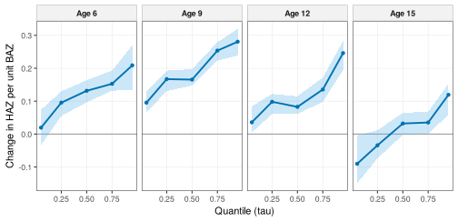
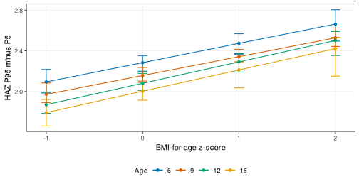
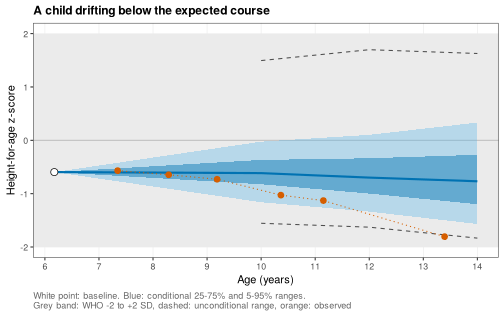
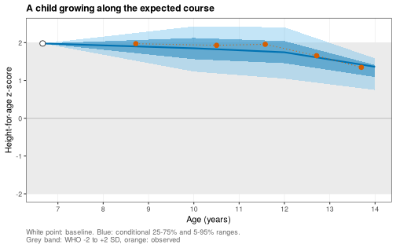
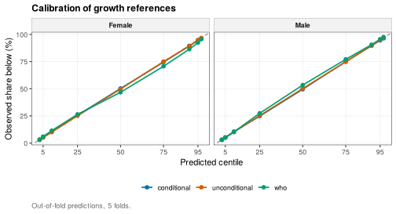
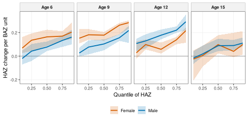
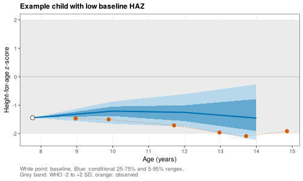

> **About this vignette.** All data are simulated with `wgh_simulate()`. The
> results show how the methods work and resemble the published patterns,
> but they are not the published findings and are not research results.
> The functions run in development mode, with 50 bootstrap replicates for the quantile models and 5-fold cross-validation for the references.

Means hide what happens at the edges of a distribution. A child at the 5th
centile of height and a child at the 95th may respond differently to the
same BMI. This vignette shows three ways of modelling the whole
distribution, each from a study of the research program:

1. how BMI relates to height-for-age at different quantiles and ages, with
   quantile regression and linear quantile mixed models (Ho 2026) [1],
2. how the spread of height-for-age changes with BMI and age, a measure of
   growth inequality (Ho 2026) [2], and
3. conditional growth references, which say where a child is expected to
   be at a later age given the child's own earlier growth (Ho 2026) [3].

The vignette is precomputed.


```r
library(WeGrowHealthR)
wgh_config("dev")
#> WeGrowHealthR run mode: dev
v <- wgh_simulate(30000, seed = 2026)$visits
fl <- wgh_sample_flow(v, "Ages 5 to 18" = ~ age >= 5 & age <= 18.5,
                      "Plausible z-scores" = ~ abs(haz) < 6 & abs(baz) < 6,
                      "At least 3 visits" = wgh_min_visits(3))
a <- fl$data
girls <- a[a$sex == "Female", ]
boys <- a[a$sex == "Male", ]
```

## 1. Quantile regression of HAZ on BAZ

The model lets the association of BAZ with HAZ change smoothly with age,
through a natural spline of age interacting with BAZ:


```r
f <- haz ~ splines::ns(age, knots = c(8, 11, 14), Boundary.knots = c(5, 18.5)) * baz
```

Write the knots and boundary knots into the formula. If they were chosen
from the data, every bootstrap replicate would get a slightly different
basis and the replicates could not be combined.

`wgh_rq()` fits the model at each quantile in `taus`, reads the BAZ slope at
the `anchor_ages` by contrast (the change in predicted HAZ when BAZ rises by
one unit at that age), and gets intervals from a bootstrap that resamples
children (`B` replicates), so repeated visits are handled correctly.


```r
fit_g <- wgh_rq(girls, f, taus = c(0.05, 0.25, 0.5, 0.75, 0.95), anchor_ages = c(6, 9, 12, 15), B = 50)
fit_g
#> <wgh_rq>: 5 quantiles, 15628 visits from 3827 children, 50 bootstrap replicates
#> Slope of baz by age and quantile:
#> # A tibble: 20 x 6
#>      age   tau estimate boot_se  lower  upper
#>    <dbl> <dbl>    <dbl>   <dbl>  <dbl>  <dbl>
#>  1     6  0.05    0.019   0.029 -0.033  0.074
#>  2     9  0.05    0.096   0.019  0.066  0.131
#>  3    12  0.05    0.036   0.021  0.005  0.084
#>  4    15  0.05   -0.09    0.039 -0.149 -0.004
#>  5     6  0.25    0.096   0.021  0.055  0.13 
#>  6     9  0.25    0.167   0.015  0.131  0.193
#>  7    12  0.25    0.098   0.017  0.061  0.122
#>  8    15  0.25   -0.034   0.022 -0.074  0.012
#>  9     6  0.5     0.132   0.019  0.097  0.164
#> 10     9  0.5     0.166   0.013  0.147  0.197
#> 11    12  0.5     0.083   0.016  0.062  0.115
#> 12    15  0.5     0.032   0.018 -0.002  0.064
#> 13     6  0.75    0.153   0.019  0.132  0.193
#> 14     9  0.75    0.254   0.016  0.223  0.28 
#> 15    12  0.75    0.135   0.016  0.098  0.172
#> 16    15  0.75    0.035   0.019  0.002  0.068
#> 17     6  0.95    0.209   0.033  0.134  0.27 
#> 18     9  0.95    0.281   0.023  0.238  0.32 
#> 19    12  0.95    0.246   0.027  0.195  0.283
#> 20    15  0.95    0.119   0.029  0.058  0.153
```

The printout gives the BAZ slope at each age and quantile with its
bootstrap standard error and interval. The same table is in `fit_g$slopes`.


```r
plot(fit_g, y_label = "Change in HAZ per unit BAZ")
```

<div class="figure">

</div>

Before puberty the slope is positive and largest at the upper quantiles:
higher BMI goes with greater height, most of all among the tallest girls. By
15 years the slope is close to zero in the middle of the distribution and
negative at the 5th centile, the same convergence seen in
`vignette("trajectories")`.

`wgh_test_heterogeneity()` tests whether the slopes at one age are equal
across quantiles, and `wgh_test_sex_difference()` whether boys and girls
differ:


```r
fit_b <- wgh_rq(boys, f, taus = c(0.05, 0.25, 0.5, 0.75, 0.95), anchor_ages = c(6, 9, 12, 15), B = 50)
wgh_test_heterogeneity(fit_g, age = 12)
#> # A tibble: 1 x 7
#>     age chi_sq    df  p_value top_minus_bottom lower upper
#>   <dbl>  <dbl> <dbl>    <dbl>            <dbl> <dbl> <dbl>
#> 1    12   72.4     4 6.99e-15            0.210 0.142 0.248
wgh_test_sex_difference(fit_b, fit_g, age = 12)$joint
#> # A tibble: 1 x 4
#>     age chi_sq    df  p_value
#>   <dbl>  <dbl> <int>    <dbl>
#> 1    12   25.0     5 0.000139
```

`wgh_slopes()` reads slopes at any other ages from the same fit, for example
`wgh_slopes(fit_g, ages = c(7, 13))`.

### Accounting for repeated visits: LQMM

Quantile regression treats visits as independent and handles clustering
only through the bootstrap. A linear quantile mixed model adds a random
intercept for each child. `wgh_lqmm()` has the same interface as `wgh_rq()`
and retries with more iterations when the optimiser warns.


```r
set.seed(1)
small <- girls[girls$id %in% sample(unique(girls$id), 600), ]
lq <- wgh_lqmm(small, f, taus = c(0.1, 0.5, 0.9), anchor_ages = c(6, 9, 12, 15), B = 0)
lq$slopes
#> # A tibble: 12 x 3
#>      age   tau estimate
#>    <dbl> <dbl>    <dbl>
#>  1     6   0.1   0.0745
#>  2     9   0.1   0.135 
#>  3    12   0.1   0.105 
#>  4    15   0.1   0.0181
#>  5     6   0.5   0.154 
#>  6     9   0.5   0.266 
#>  7    12   0.5   0.163 
#>  8    15   0.5   0.0344
#>  9     6   0.9   0.0203
#> 10     9   0.9   0.0821
#> 11    12   0.9  -0.0102
#> 12    15   0.9  -0.118
lq$convergence
#> # A tibble: 3 x 6
#>     tau ok    converged ladder_step method messages
#>   <dbl> <lgl> <lgl>           <dbl> <chr>  <chr>   
#> 1   0.1 TRUE  TRUE                1 gs     ""      
#> 2   0.5 TRUE  TRUE                1 gs     ""      
#> 3   0.9 TRUE  TRUE                1 gs     ""
```

The `convergence` table reports, for each quantile, whether the fit
converged, which step of the retry ladder was needed and the messages of the
failed attempts.

## 2. Growth inequality: the spread of height-for-age

The same quantile model describes the spread of the distribution. The
distance between the 95th and the 5th centile of HAZ (`range90`) and the
interquartile range (`iqr`) can be read at any age and BAZ.
`wgh_dispersion()` does that, with bootstrap intervals, and also reports the
change in spread per unit of BAZ.


```r
dsp <- wgh_dispersion(fit_g, ages = c(6, 9, 12, 15), exposure_values = c(-1, 0, 1, 2, 3))
head(dsp$spread)
#> # A tibble: 6 x 8
#>     age   baz range90   iqr range90_lower range90_upper iqr_lower iqr_upper
#>   <dbl> <dbl>   <dbl> <dbl>         <dbl>         <dbl>     <dbl>     <dbl>
#> 1     6    -1    2.09 0.857          1.98          2.22     0.794     0.903
#> 2     9    -1    1.97 0.723          1.89          2.08     0.665     0.763
#> 3    12    -1    1.87 0.798          1.78          1.99     0.751     0.842
#> 4    15    -1    1.79 0.751          1.66          1.92     0.676     0.825
#> 5     6     0    2.28 0.915          2.20          2.35     0.865     0.954
#> 6     9     0    2.16 0.810          2.10          2.24     0.770     0.850
dsp$change
#> # A tibble: 4 x 7
#>     age range90_per_unit iqr_per_unit range90_lower range90_upper iqr_lower iqr_upper
#>   <dbl>            <dbl>        <dbl>         <dbl>         <dbl>     <dbl>     <dbl>
#> 1     6            0.189       0.0573        0.107          0.243   0.0138     0.0951
#> 2     9            0.185       0.0867        0.142          0.234   0.0656     0.115 
#> 3    12            0.210       0.0375        0.142          0.248   0.00278    0.0667
#> 4    15            0.210       0.0693        0.0759         0.269   0.0157     0.108
```

A spread read at a BAZ where few children are measured is an extrapolation.
`wgh_support()` counts the children near each age and BAZ and flags the
supported cells:


```r
sup <- wgh_support(girls, "baz", ages = c(6, 9, 12, 15), exposure_values = c(-1, 0, 1, 2, 3))
head(sup)
#> # A tibble: 6 x 4
#>     age   baz n_local supported
#>   <dbl> <dbl>   <int> <lgl>    
#> 1     6    -1     107 TRUE     
#> 2     9    -1     162 TRUE     
#> 3    12    -1      88 TRUE     
#> 4    15    -1      82 TRUE     
#> 5     6     0     200 TRUE     
#> 6     9     0     282 TRUE
```


```r
sp <- merge(dsp$spread, sup[, c("age", "baz", "supported")], by = c("age", "baz"))
library(ggplot2)
ggplot(sp[sp$supported, ], aes(baz, range90, colour = factor(age))) +
  geom_errorbar(aes(ymin = range90_lower, ymax = range90_upper), width = 0.1) +
  geom_line() + geom_point() + scale_colour_wgh() + theme_wgh() +
  labs(x = "BMI-for-age z-score", y = "HAZ P95 minus P5", colour = "Age")
```

<div class="figure">

</div>

In these simulated girls the spread widens by about 0.2 HAZ units for each
unit of BAZ at every age (`dsp$change`): girls with higher BMI differ more
from each other in height than girls with normal BMI, a form of growth
inequality that a mean model cannot show.

## 3. Conditional growth references

A WHO chart compares a child with all children of the same age and sex. A
conditional reference compares the child with children who had the same
starting point. It answers a clinical question: given this child's height
and BMI at 6 years, where should the child's height-for-age be at 10, 12 or
14 years? A child who stays inside the WHO band can still fall well below
the course expected from the child's own history, and that is what a
conditional reference detects.

### A cohort with long follow-up

Conditional references need children measured both in a conditioning
window and years later. The simulation settings below give a cohort followed
for 14 school years with little dropout: `years` sets the calendar years,
`dropout` the yearly probability of leaving, and `entry_first_prob` the
share of children enrolled from their first eligible year.


```r
long <- wgh_simulate(12000, preset = "reference", seed = 11, years = 2012:2025,
                     dropout = c(intercept = -4, age = 0), entry_first_prob = 0.9)$visits
```

### Building the panel

`wgh_conditional_panel()` takes, for each child, the visit nearest `anchor`
(6 years) within the conditioning `window` as the baseline, a second visit
near `anchor2` for a slope, and the visit nearest each target age (within
`tol` years) as the outcome. Children are not dropped for lacking the second
visit.


```r
cp <- wgh_conditional_panel(long, window = c(5, 9), anchor = 6, anchor2 = 8, targets = c(10, 12, 14))
table(cp$sex, cp$target_nominal)
#>         
#>            10   12   14
#>   Male   1071  647  267
#>   Female  978  650  285
head(cp[, c("id", "sex", "baseline_age", "baseline_haz", "baseline_baz", "target_nominal", "target_age", "target")])
#> # A tibble: 6 x 8
#>   id      sex    baseline_age baseline_haz baseline_baz target_nominal target_age target
#>   <chr>   <fct>         <dbl>        <dbl>        <dbl>          <dbl>      <dbl>  <dbl>
#> 1 C000004 Male           5.53        2.82         0.314             10       9.56  1.93 
#> 2 C000005 Male           7.11       -0.126       -0.486             10      10.2  -0.659
#> 3 C000007 Male           5.92        1.44         1.74              10       9.83  0.696
#> 4 C000010 Male           5.72        0.218        0.164             10      10.5  -0.071
#> 5 C000011 Male           5.53        1.05         0.632             10      10.4   1.17 
#> 6 C000014 Female         6.42       -0.973        0.955             10      10.3  -0.088
```

### Fitting the references

`wgh_condref()` fits quantile regressions of the target HAZ on the baseline
features, by sex and target age, over a grid of quantiles. The `formula`
sets the baseline features (default baseline HAZ, BAZ and age). Three
benchmarks are stored alongside: the unconditional reference (the target
distribution ignoring the baseline), persistence (baseline plus the typical
change) and the WHO band (standard normal quantiles).


```r
cr <- wgh_condref(cp)
cr
#> <wgh_condref>: 6 sex-by-target models, 9 quantiles
#> # A tibble: 6 x 3
#>   sex    target     n
#>   <chr>   <dbl> <int>
#> 1 Male       10  1071
#> 2 Female     10   978
#> 3 Male       12   647
#> 4 Female     12   650
#> 5 Male       14   267
#> 6 Female     14   285
```

`predict()` returns the predicted quantiles for any child, under the
conditional model or a benchmark (`type`):


```r
child <- cp[cp$target_nominal == 14 & cp$baseline_haz < -1, ][1, ]
round(predict(cr, child), 2)
#>      q0.030 q0.050 q0.100 q0.250 q0.500 q0.750 q0.900 q0.950 q0.970
#> [1,]  -2.35  -2.32  -2.21  -2.02  -1.56  -0.93  -0.56  -0.38  -0.33
round(predict(cr, child, type = "who"), 2)
#>      q0.030 q0.050 q0.100 q0.250 q0.500 q0.750 q0.900 q0.950 q0.970
#> [1,]  -1.88  -1.64  -1.28  -0.67      0   0.67   1.28   1.64   1.88
```

For this child, who started below -1 HAZ, the conditional range at 14 years
is centred well below zero, near the child's own level, and is much narrower
than the WHO range.

### Showing one child: the fan chart

`wgh_plot_fan()` draws the expected course. The fan opens at the baseline
measurement (known, so it has no width) and widens to the predicted 25th to
75th and 5th to 95th centile ranges at each target age. The grey band is the
WHO -2 to +2 SD range, `show_unconditional = TRUE` adds the cohort's
unconditional range, and `observed` overlays the child's later
measurements.

Here is a child whose height-for-age drifted downwards. We find such a child
with `wgh_condref_centile()` (next section): flagged below the conditional
3rd centile at 14 years, yet still inside the WHO band.


```r
sc <- wgh_condref_centile(cr, cp)
full <- names(which(table(cp$id) == 3))
drift <- sc[sc$target_nominal == 14 & sc$cond_flag == "below" & sc$target > -2 & sc$id %in% full, ][1, ]
drift[, c("id", "sex", "baseline_age", "baseline_haz", "target", "cond_centile")]
#> # A tibble: 1 x 6
#>   id      sex   baseline_age baseline_haz target cond_centile
#>   <chr>   <fct>        <dbl>        <dbl>  <dbl>        <dbl>
#> 1 C001571 Male          6.17       -0.596  -1.81         3.00
```


```r
later <- long[long$pid == drift$id & long$age > drift$baseline_age, c("age", "haz")]
wgh_plot_fan(cr, drift, observed = later, show_unconditional = TRUE,
             title = "A child drifting below the expected course")
```

<div class="figure">

</div>

Every measurement of this child stays inside the WHO band, so a standard
growth chart raises no alarm. The conditional fan shows that the child
started inside the expected course and left it, which is the signal a
clinician would want to see. For contrast, a child growing as expected:


```r
typ <- sc[sc$target_nominal == 14 & abs(sc$cond_centile - 50) < 10 & sc$id %in% full, ][1, ]
later_t <- long[long$pid == typ$id & long$age > typ$baseline_age, c("age", "haz")]
wgh_plot_fan(cr, typ, observed = later_t, title = "A child growing along the expected course")
```

<div class="figure">

</div>

### Conditional centiles and flags

`wgh_condref_centile()` places each observed target value in its predicted
distribution. `cond_centile` is the conditional centile (0 to 100),
`cond_z` its normal score, and `cond_flag` is `"below"` or `"above"` when the
centile is outside 3 to 97 (`flag`).


```r
table(sc$target_nominal, sc$cond_flag)
#>     
#>      above below within
#>   10    60    61   1928
#>   12    39    39   1219
#>   14    15    18    519
# children inside the WHO band but outside their own expected range
mean(abs(sc$target) < 2 & sc$cond_flag != "within", na.rm = TRUE)
#> [1] 0.05207799
```

### Are the references any good?

A reference is useful if its ranges are both honest and narrow.
`wgh_condref_cv()` fits the references on part of the children and scores
them on the others (`folds` child-level folds, or `folds = "site"` to leave
one site out):

* `crps` (continuous ranked probability score) and `wis` (weighted interval
  score) measure the accuracy of the whole predicted distribution. Lower is
  better.
* `coverage_90` is the share of children inside the predicted 90% range. It
  should be close to 0.90.
* `width_90` is the width of that range. Narrower is more useful, as long
  as coverage holds.


```r
cv <- wgh_condref_cv(cp, folds = 5)
aggregate(cbind(crps, wis, coverage_90, width_90) ~ model, data = cv, FUN = mean)
#>           model      crps       wis coverage_90 width_90
#> 1   conditional 0.2318450 0.1925505   0.8888939 1.330110
#> 2   persistence 0.2919781 0.2450583   0.8960622 1.769993
#> 3 unconditional 0.5573599 0.4627864   0.8961755 3.308607
#> 4           who 0.5589127 0.4642847   0.8903847 3.289707
```

All four references cover about 90% of children, so all are honest. The
conditional reference has by far the lowest CRPS and WIS and a 90% range
less than half as wide as the WHO range: it says much more about each child
for the same honesty. Persistence is in between, because it uses the
baseline but ignores BMI and regression to the mean.

### A flexible benchmark and a child-by-child comparison

Is the linear conditional reference too simple? A quantile random forest
(`wgh_quantile_forest()`, built on `ranger`) makes no assumption about the
shape of the relationship, so it is a demanding benchmark (Book 2 Chapter
15). `forest = TRUE` adds it to the cross-validation.

Comparing average scores across models ignores that the models predict the
same children. `wgh_condref_compare()` scores every held-out prediction and
compares two references child by child, with a bootstrap that resamples
children (`wgh_paired_scores()`, Book 2 Chapter 16). A negative difference
means the model scores better than the reference.


```r
cmp <- wgh_condref_compare(cp, models = c("conditional", "persistence", "forest"), reference = "who",
                           folds = 5, B = 500)
cmp[, c("model", "reference", "mean_new", "mean_old", "mean_diff", "lower", "upper", "relative_change_pct")]
#> # A tibble: 3 x 8
#>   model       reference mean_new mean_old mean_diff  lower  upper relative_change_pct
#>   <chr>       <chr>        <dbl>    <dbl>     <dbl>  <dbl>  <dbl>               <dbl>
#> 1 conditional who          0.218    0.566    -0.348 -0.365 -0.331               -61.5
#> 2 persistence who          0.276    0.566    -0.290 -0.310 -0.271               -51.2
#> 3 forest      who          0.243    0.566    -0.322 -0.340 -0.306               -57.0
wgh_condref_compare(cp, models = "forest", reference = "conditional", folds = 5, B = 500)[,
  c("model", "reference", "mean_diff", "lower", "upper", "relative_change_pct")]
#> # A tibble: 1 x 6
#>   model  reference   mean_diff  lower  upper relative_change_pct
#>   <chr>  <chr>           <dbl>  <dbl>  <dbl>               <dbl>
#> 1 forest conditional    0.0256 0.0214 0.0300                11.7
```

The first table shows how much each reference improves on the WHO band for
the same children. The second asks whether the forest improves on the
linear conditional reference. When its interval lies above zero the forest
is worse, and the simpler linear model, which can be written as an equation
and explained, is preferred.

`wgh_plot_condref_calibration()` checks every quantile, not only the 90%
range, with out-of-fold predictions. Points on the diagonal mean that, for
example, 10% of children fall below the predicted 10th centile.


```r
wgh_plot_condref_calibration(cp, folds = 5)
```

<div class="figure">

</div>

## 4. The three studies in one call each


```r
dist <- wgh_flow_distributional_height(v, engine = "rq")
dist
#> 
#> -- BMI and the height-for-age distribution (Ho 2026, medRxiv 2026.09.08.26362487) --
#> 
#> Tables (6): mean_model_slopes_male, mean_model_slopes_female, quantile_slopes, heterogeneity,
#> sex_difference, crossing
#> Figures (2): fig_coefficient_functions, fig_spread_by_bmi
#> Models: Male, Male_mean, Female, Female_mean
#> Model status: 14 ok, 0 failed, 1 skipped
#> skipped: qgam sensitivity analysis (sensitivity = FALSE)
#> Settings: mode = dev; engine = rq
ineq <- wgh_flow_growth_inequality(v)
ineq$tables$change_per_baz
#> # A tibble: 8 x 8
#>   sex      age range90_per_unit iqr_per_unit range90_lower range90_upper iqr_lower iqr_upper
#>   <chr>  <dbl>            <dbl>        <dbl>         <dbl>         <dbl>     <dbl>     <dbl>
#> 1 Male       6           0.209        0.0874       0.157          0.291     0.0437    0.112 
#> 2 Male       9           0.133        0.0606       0.0729         0.197     0.0345    0.0805
#> 3 Male      12           0.143        0.0482       0.111          0.180     0.0239    0.0805
#> 4 Male      15           0.0385       0.0386       0.00390        0.0763    0.0146    0.0539
#> 5 Female     6           0.188        0.0527       0.0843         0.207     0.0171    0.0828
#> 6 Female     9           0.190        0.0931       0.155          0.208     0.0654    0.119 
#> 7 Female    12           0.206        0.0395       0.132          0.231     0.0345    0.0540
#> 8 Female    15           0.196        0.0632       0.112          0.221     0.0402    0.110
cond <- wgh_flow_conditional_references(long, window = c(5, 9), targets = c(10, 12, 14))
cond$tables$cv_scores
#>            model    sex target    pinball      crps       wis coverage_50 coverage_80 coverage_90
#> 1    conditional Female     10 0.06983372 0.1995711 0.1658661   0.4976136   0.7894143   0.8965957
#> 2    persistence Female     10 0.07607094 0.2148409 0.1797830   0.4966910   0.8025468   0.8947168
#> 3  unconditional Female     10 0.21706175 0.6217823 0.5154982   0.4948892   0.7971856   0.8934567
#> 4            who Female     10 0.21850623 0.6242113 0.5187479   0.4200603   0.7284731   0.8439935
#> 5    conditional   Male     10 0.06239548 0.1767435 0.1473788   0.5012924   0.7992373   0.8973677
#> 6    persistence   Male     10 0.09858741 0.2761708 0.2322708   0.5033466   0.7992391   0.8975730
#> 7  unconditional   Male     10 0.18187642 0.5193254 0.4315325   0.4939049   0.7955761   0.9000547
#> 8            who   Male     10 0.18198792 0.5191820 0.4316313   0.5171192   0.8124256   0.9233869
#> 9    conditional Female     12 0.08563229 0.2439259 0.2029591   0.5002546   0.7952787   0.8861766
#> 10   persistence Female     12 0.09541890 0.2701642 0.2256561   0.4964062   0.7983967   0.9039507
#> 11 unconditional Female     12 0.20963943 0.6054765 0.4993672   0.4935375   0.7919666   0.8942744
#> 12           who Female     12 0.21103738 0.6086360 0.5029292   0.4286913   0.7340165   0.8620202
#> 13   conditional   Male     12 0.08912708 0.2528597 0.2108155   0.5003241   0.7851934   0.8810167
#> 14   persistence   Male     12 0.11795218 0.3298829 0.2784144   0.5005689   0.7964596   0.8925374
#> 15 unconditional   Male     12 0.19125672 0.5430587 0.4532136   0.4902063   0.8025505   0.8960094
#> 16           who   Male     12 0.19135235 0.5440629 0.4534606   0.4923007   0.8004082   0.8955677
#> 17   conditional Female     14 0.07404743 0.2105119 0.1748415   0.4760269   0.7797074   0.8781779
#> 18   persistence Female     14 0.11415930 0.3201106 0.2691987   0.4957428   0.7837520   0.8923284
#> 19 unconditional Female     14 0.16414099 0.4667632 0.3892111   0.5060887   0.7970958   0.8947541
#> 20           who Female     14 0.16622989 0.4724438 0.3941396   0.5485457   0.8601954   0.9436541
#> 21   conditional   Male     14 0.10980716 0.3145168 0.2601730   0.4908944   0.7701144   0.8634835
#> 22   persistence   Male     14 0.12357761 0.3501622 0.2924892   0.5051118   0.7860130   0.8869090
#> 23 unconditional   Male     14 0.20082339 0.5755862 0.4771739   0.4983274   0.7995733   0.8925329
#> 24           who   Male     14 0.20279486 0.5822913 0.4824127   0.4305257   0.7792285   0.8775730
#>     width_50  width_80 width_90
#> 1  0.4983674 0.9510743 1.208031
#> 2  0.5252500 1.0043667 1.288867
#> 3  1.6118333 2.9297000 3.647383
#> 4  1.3489795 2.5631031 3.289707
#> 5  0.4292926 0.8333050 1.041957
#> 6  0.6523333 1.2677000 1.657967
#> 7  1.2715833 2.4791000 3.058750
#> 8  1.3489795 2.5631031 3.289707
#> 9  0.6281252 1.1368128 1.411351
#> 10 0.6714167 1.2415333 1.631767
#> 11 1.5591667 2.9013000 3.549417
#> 12 1.3489795 2.5631031 3.289707
#> 13 0.6577805 1.1616802 1.460759
#> 14 0.7400833 1.4937333 2.116167
#> 15 1.3595833 2.5419000 3.301850
#> 16 1.3489795 2.5631031 3.289707
#> 17 0.4893853 0.9306803 1.192417
#> 18 0.7506667 1.4055000 1.922283
#> 19 1.2069167 2.1797000 2.810467
#> 20 1.3489795 2.5631031 3.289707
#> 21 0.8705319 1.4233293 1.682282
#> 22 0.9244167 1.5242333 2.000450
#> 23 1.4826667 2.6193333 3.450150
#> 24 1.3489795 2.5631031 3.289707
cond$tables$flags
#>      sex target_nominal below above
#> 1   Male             10   3.0   2.9
#> 2 Female             10   3.0   3.0
#> 3   Male             12   2.9   2.9
#> 4 Female             12   3.1   3.1
#> 5   Male             14   3.4   2.6
#> 6 Female             14   3.2   2.8
```


```r
plot(dist, "fig_coefficient_functions")
```

<div class="figure">

</div>


```r
plot(cond, "fig_fan_low")
```

<div class="figure">

</div>

`engine = "lqmm"` (default) uses linear quantile mixed models as in the
study, and `sensitivity = TRUE` adds a smooth quantile regression check with
`qgam`. Both are slower.

## Where to go next

* `vignette("prediction")` explains individual conditional predictions with
  SHAP values.
* `vignette("phenotypes-states")` looks at movement between height bands
  over time.

## References

1. Ho NT. The age-varying association between BMI and height-for-age in Vietnamese schoolchildren: a sex-stratified quantile regression study. medRxiv. 2026. 2026.09.08.26362487. https://doi.org/10.64898/2026.09.08.26362487

2. Ho NT. Growth inequality over age and BMI in Vietnamese children: age-varying dispersion of the conditional height-for-age distribution from quantile regression. Manuscript under review. 2026.

3. Ho NT. Conditional growth references for Vietnamese children: quantile regression of growth distributions and phenotypes. medRxiv. 2026. 2026.09.23.26363771. https://doi.org/10.64898/2026.09.23.26363771
