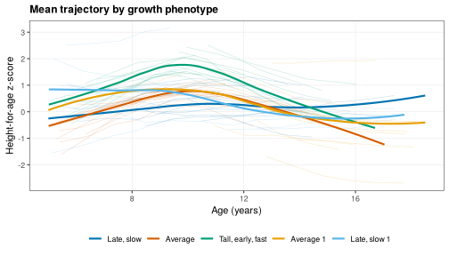
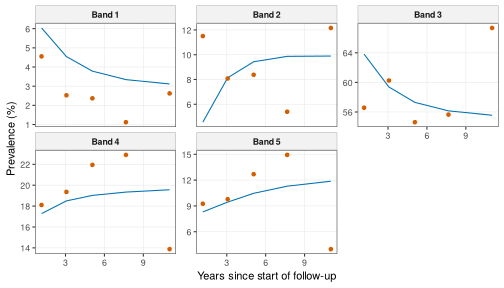
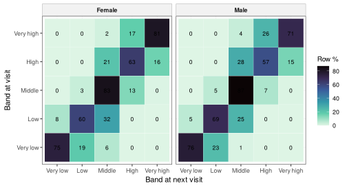

> **About this vignette.** All data are simulated with `wgh_simulate()`. The
> results show how the methods work and resemble the published patterns,
> but they are not the published findings and are not research results.
> The functions run in development mode: SITAR models use at most 1,000 children and the cluster stability 20 bootstrap refits.

Children do not all grow along the same path. Some are tall early and stop
early, others start small and catch up. This vignette shows two ways of
describing that variety, each from a study of the research program:

1. growth phenotypes, groups of children with similar peri-pubertal growth
   found by functional clustering (Ho 2026) [1], and their links with later
   outcomes on the growth side (Ho 2026) [2], and
2. canalization, the tendency to stay in the same height band, with
   catch-up and catch-down movements between bands and multistate models
   (Ho 2026) [3].

The vignette is precomputed.

Phenotypes need children followed through puberty, so this part uses a
simulated cohort followed for 14 school years with little dropout (see
`vignette("simulated-data")` for the settings).


```r
library(WeGrowHealthR)
wgh_config("dev")
#> WeGrowHealthR run mode: dev
long <- wgh_simulate(8000, seed = 7, years = 2012:2025, missing_years = integer(),
                     dropout = c(intercept = -4, age = 0), entry_first_prob = 0.9)$visits
length(unique(long$pid))
#> [1] 5664
```

## 1. Summarising trajectories with functional PCA

Visits are sparse and irregular, so trajectories cannot be compared point by
point. `wgh_fpca()` summarises each child's HAZ trajectory with functional
principal component scores using PACE (`fdapace`), which borrows strength
across children. `min_visits` and `min_span` set who is eligible (4 visits
over 3 years in [1]), and `fve` the share of variance the components must
explain.

We use girls here, whose pubertal timing varies more.


```r
girls <- long[long$sex == "Female", ]
fp <- wgh_fpca(girls, age_range = c(5, 18))
fp$fve
#> [1] 0.6560494 0.9310798 0.9989827
head(fp$scores)
#> # A tibble: 6 x 5
#>   id      sex      fpc1     fpc2   fpc3
#>   <chr>   <fct>   <dbl>    <dbl>  <dbl>
#> 1 C000001 Female  2.45   0.337    0.472
#> 2 C000008 Female -0.174 -1.09    -1.11 
#> 3 C000013 Female -1.20   0.829    0.133
#> 4 C000021 Female -2.93  -0.214    1.02 
#> 5 C000029 Female  3.15   0.00437  0.365
#> 6 C000031 Female -0.725 -2.13    -0.910
```

`fve` is the cumulative share of variance explained by the components. The
first component (`fpc1`) is usually overall level (tall or short
throughout), and the second a change in level with age (catching up or
falling behind).

## 2. Adding SITAR timing and intensity

Peri-pubertal growth also differs in timing and intensity, which SITAR
measures (`vignette("growth-curves")`).


```r
fit <- wgh_fit_sitar(girls, df = 4, age_range = c(6, 16))
#> SITAR fitted to a random 1000 of 1203 children (run mode "dev").
eff <- wgh_sitar_effects(fit)
feat <- merge(fp$scores, eff[, c("id", "a", "b", "c")], by = "id")
head(feat)
#>        id    sex       fpc1         fpc2       fpc3          a          b           c
#> 1 C000008 Female -0.1740718 -1.089256578 -1.1064218   6.725747  1.3993209 -0.15715992
#> 2 C000021 Female -2.9321896 -0.213685529  1.0236519 -11.742932 -1.0800851  0.08992150
#> 3 C000029 Female  3.1490619  0.004374539  0.3645803   5.000962 -0.1378443  0.09131556
#> 4 C000031 Female -0.7251193 -2.134537897 -0.9103852   7.568388  1.7988658 -0.11386548
#> 5 C000043 Female -0.8042063  0.378626049  0.2431304  -3.450238 -0.2361255  0.03392146
#> 6 C000049 Female  2.3671544 -0.260595558  0.1161995   5.126203  0.1124899  0.02968320
```

## 3. Clustering

`wgh_cluster()` fits Gaussian mixture models (`mclust`) with `G` clusters
over a range, standardises the features (`scale = TRUE`) and chooses the
number of clusters by BIC or ICL (`criterion`). It warns when the chosen
number is at an edge of the range, because then the search should be
widened. `wgh_name_phenotypes()` names each cluster from its centroid on
size, timing and tempo, so the names are reproducible.

SITAR size `a` is left out because `fpc1` already describes overall level.


```r
cl <- wgh_name_phenotypes(wgh_cluster(feat, vars = c("fpc1", "fpc2", "b", "c"), G = 1:8))
cl
#> <wgh_phenotypes>: 5 clusters (VVV) chosen by BIC for 868 children
#> 
#>        Late, slow           Average Tall, early, fast         Average 1      Late, slow 1 
#>              30.1              21.7              20.5              20.4               7.4
cl$centroids
#> # A tibble: 5 x 7
#>   cluster name               share   fpc1   fpc2       b       c
#>     <dbl> <chr>              <dbl>  <dbl>  <dbl>   <dbl>   <dbl>
#> 1       1 Late, slow        0.301  -0.338 -0.966  0.865  -0.793 
#> 2       2 Average           0.217  -0.261 -0.170 -0.483   0.223 
#> 3       3 Tall, early, fast 0.205   0.807  0.981 -0.974   1.22  
#> 4       4 Average 1         0.204  -0.135  0.484 -0.0520 -0.0210
#> 5       5 Late, slow 1      0.0737  0.274  0.374  0.746  -0.748
```

The centroids are in standard deviation units. A phenotype named "Tall,
early, fast" has a high `fpc1`, a negative timing `b` and a positive
intensity `c`. Clusters close to the mean on every feature are called
"Average" and numbered.


```r
wgh_plot_phenotypes(cl, girls[girls$age >= 5, ], "haz", show_children = 15)
```

<div class="figure">

</div>

`show_children` draws a few children of each phenotype behind the mean
curves, which shows how much the children within a phenotype differ.

### Are the phenotypes stable and meaningful?

`wgh_cluster_stability()` refits the clustering on bootstrap samples and
reports the adjusted Rand index (ARI) with the original clustering. An ARI
near 1 means the phenotypes are found again and again.
`wgh_cluster_neighbours()` refits with one cluster fewer and one more and
cross-tabulates the memberships, which shows which phenotypes merge or
split.


```r
st <- wgh_cluster_stability(cl, B = 20)
attr(st, "summary")
#>      median  lower.2.5% upper.97.5% 
#>   0.3947005   0.1902214   0.5457367
wgh_cluster_neighbours(cl)
#> $G4
#>         neighbour
#> original   1   2   3   4
#>        1  96   4 123  38
#>        2   2  23 160   3
#>        3   1 161   7   9
#>        4   0   1   3 173
#>        5  45   7   3   9
#> 
#> $G6
#>         neighbour
#> original   1   2   3   4   5   6
#>        1  40  42   0   6  81  92
#>        2   0 171   0   0  17   0
#>        3   1   2 158   5  12   0
#>        4   0   1   0 169   7   0
#>        5  28   7   3  11   0  15
```

`wgh_validate_phenotypes()` checks the phenotypes against characteristics
that were not used to build them, here prepubertal BMI category and site,
with a multinomial model and a likelihood ratio test for each:


```r
pre <- wgh_index_exposure(girls, "baz", name = "pre",
                          categories = function(b, a) wgh_bmi_category(b, a, thinness = FALSE))
pre <- pre[!duplicated(pre$id), c("id", "pre_cat", "site")]
wgh_validate_phenotypes(cl, pre, c("pre_cat", "site"))$tests
#> # A tibble: 2 x 4
#>   covariate    LR    df p_value
#>   <chr>     <dbl> <dbl>   <dbl>
#> 1 pre_cat   23.5      8 0.00281
#> 2 site       6.59     8 0.582
```

A small p-value for prepubertal BMI, as here, means the phenotypes differ in
BMI before puberty, although BMI was not a clustering feature. Site should not
differ, so a small p-value there would point to a data problem.

## 4. Phenotypes and later outcomes

`wgh_link_outcome()` models a later outcome as a function of phenotype
membership with a bootstrap over children: a linear model for a continuous
outcome, logistic for a binary one. `exposure = "b"` instead uses a
continuous feature for a dose-response model.


```r
late <- girls[girls$age >= 15, ]
late <- aggregate(cbind(haz, baz) ~ pid, data = late, FUN = median)
names(late) <- c("id", "haz_late", "baz_late")
late$ow_ob_late <- as.integer(late$baz_late > 1)
wgh_link_outcome(cl, late, "haz_late", B = 50)
#> # A tibble: 4 x 4
#>   term                       estimate  lower  upper
#>   <chr>                         <dbl>  <dbl>  <dbl>
#> 1 phenotypeLate, slow          0.718   0.585 0.891 
#> 2 phenotypeAverage            -0.175  -0.366 0.0275
#> 3 phenotypeTall, early, fast   0.486   0.241 0.804 
#> 4 phenotypeLate, slow 1        0.0975 -0.110 0.352
wgh_link_outcome(cl, late, "ow_ob_late", B = 50)
#> Warning: Fewer than 5 outcome events in phenotype(s) Average, Late, slow 1: estimates are unstable.
#> # A tibble: 4 x 7
#>   term                       estimate   lower upper odds_ratio     or_lower or_upper
#>   <chr>                         <dbl>   <dbl> <dbl>      <dbl>        <dbl>    <dbl>
#> 1 phenotypeLate, slow         -0.330   -0.772 0.212      0.719 0.462            1.24
#> 2 phenotypeAverage            -0.0889 -12.9   0.871      0.915 0.00000259       2.39
#> 3 phenotypeTall, early, fast   1.80     0.677 3.11       6.04  1.97            22.5 
#> 4 phenotypeLate, slow 1       -0.736  -16.2   1.26       0.479 0.0000000896     3.52
```

The largest phenotype is the reference. For a continuous outcome
`estimate` is the difference in mean late HAZ from the reference, and for a
binary outcome the odds ratio is given with its bootstrap interval. A
warning flags phenotypes with very few outcome events, whose estimates are
unstable.

The phenotypes were built from visits up to 18 years. Using them to predict
height at 15 or 18 years would leak the outcome into the predictor, and
`wgh_leakage_check()` warns about that:


```r
wgh_leakage_check(c(5, 18), c(12, 15, 18))$message
#> [1] "Leakage: the feature window reaches 18 y, overlapping target age(s) 12, 15, 18."
```

## 5. Height bands and canalization

`wgh_states()` puts every visit in one of five HAZ bands, cut at the 10th,
25th, 75th and 90th centiles of the standard normal distribution
(`percentiles`). `wgh_transitions()` pairs consecutive visits 0.5 to 2.5
years apart (`min_interval`, `max_interval`) and flags staying in the band,
moving up or down, catch-up (moving up from the two lowest bands) and
catch-down (moving down from the two highest bands).


```r
sim_v <- wgh_simulate(30000, seed = 2026)
v <- sim_v$visits
stt <- wgh_states(v[v$age >= 5, ])
table(stt$band)
#> 
#>  Very low       Low    Middle      High Very high 
#>      1521      5029     27912      8961      4827
tr <- wgh_transitions(stt)
head(tr[, c("id", "age", "age_next", "from_band", "to_band", "persist", "catch_up", "catch_down")])
#> # A tibble: 6 x 8
#>   id        age age_next from_band to_band persist catch_up catch_down
#>   <chr>   <dbl>    <dbl> <fct>     <fct>   <lgl>   <lgl>    <lgl>     
#> 1 C000003  7.65     8.61 Middle    Middle  TRUE    FALSE    FALSE     
#> 2 C000003  8.61    10.6  Middle    Middle  TRUE    FALSE    FALSE     
#> 3 C000003 10.6     11.7  Middle    High    FALSE   FALSE    FALSE     
#> 4 C000003 11.7     12.4  High      High    TRUE    FALSE    FALSE     
#> 5 C000004  5.85     6.66 Low       Low     TRUE    FALSE    FALSE     
#> 6 C000005  7.63     8.61 Middle    Middle  TRUE    FALSE    FALSE
```


```r
tm <- wgh_transition_matrix(tr, by = "sex")
head(tm)
#> # A tibble: 6 x 5
#>   sex   from      to           n row_pct
#>   <chr> <chr>     <chr>    <int>   <dbl>
#> 1 Male  Very low  Very low   423 76.4   
#> 2 Male  Low       Very low    87  5.15  
#> 3 Male  Middle    Very low     1  0.0122
#> 4 Male  High      Very low     0  0     
#> 5 Male  Very high Very low     0  0     
#> 6 Male  Very low  Low        127 22.9
wgh_canalization_summary(tr, by = "sex")
#> # A tibble: 6 x 7
#>   sex    age_block transitions persistence catch_up catch_down toward_median
#>   <chr>  <chr>           <int>       <dbl>    <dbl>      <dbl>         <dbl>
#> 1 Male   [5,9)            6945        85.7    17.5       23.9          21.2 
#> 2 Female [5,9)            6034        72.4    74.9        6.14         16.0 
#> 3 Male   [9,13)           4537        70.9    48.5        9.51         22.3 
#> 4 Female [9,13)           4291        74.9    26.1       35.4          35.1 
#> 5 Male   [13,19)          2867        69.1     4.47      70.6          53.2 
#> 6 Female [13,19)          2770        88.9     5.82      19.8           9.96
```

The transition matrix gives, for each starting band, the share of children
in each band at the next visit (`row_pct`). Most children stay in their
band, which is canalization. Children in the outer bands move towards the
middle more often than children in the middle move out.

### How much movement is measurement error?

A child near a cut-off can change band because of a few millimetres of
measurement error. `wgh_false_moves()` measures how often that happens. It
redraws every measured height from the error-free height with a chosen
error SD (`error_sds`, in cm), rounds it as a school scale would, and
compares the measured transitions with the error-free ones. The simulation
truth file holds the error-free height. With real data the recorded height
is used instead, and the result is a lower bound.


```r
fm <- wgh_false_moves(sim_v, error_sds = c(0.5, 1, 1.5))
fm
#> # A tibble: 3 x 6
#>   error_sd_cm n_transitions persistence_pct observed_moves_pct false_moves_pct missed_moves_pct
#>         <dbl>         <int>           <dbl>              <dbl>           <dbl>            <dbl>
#> 1         0.5         37054            77.5               22.5            34.9             22.9
#> 2         1           37054            71.8               28.2            54.4             32.2
#> 3         1.5         37054            65.2               34.8            65.6             36.7
attr(fm, "by_band")[attr(fm, "by_band")$error_sd_cm == 1, ]
#> # A tibble: 5 x 5
#>   error_sd_cm from_band n_transitions observed_moves_pct false_moves_pct
#>         <dbl> <fct>             <int>              <dbl>           <dbl>
#> 1           1 Very low           1932               40.5            51.3
#> 2           1 Low                3918               46.8            60.1
#> 3           1 Middle            20104               17.6            53.0
#> 4           1 High               6810               45.1            53.6
#> 5           1 Very high          4290               28.5            53.8
```

`false_moves_pct` is the share of observed band changes in which the
child's error-free band did not change. It rises quickly with measurement
error. By starting band, children in the narrow bands next to the middle
change band most often (`observed_moves_pct`), because a small error is
enough to cross a cut-off, and with 1 cm of error about half of all observed
changes are false in every band. Report this alongside any transition
matrix (Book 2 Chapter 12).

### Regression to the mean

Part of that movement towards the middle is regression to the mean, not
real catch-up. `wgh_rtm()` computes the conditional change score
(z2 - r z1) / sqrt(1 - r^2), which is zero on average for every starting
value if there is no true catch-up.


```r
rt <- wgh_rtm(tr, v)
tapply(rt$z2 - rt$z1, rt$from_band, mean)
#>    Very low         Low      Middle        High   Very high 
#>  0.10118132  0.08291426  0.03521945 -0.01886839 -0.08320621
tapply(rt$conditional_z, rt$from_band, mean)
#>    Very low         Low      Middle        High   Very high 
#> -0.03185809  0.04551918  0.10090865  0.13109738  0.11496153
```

The raw change is positive in the low bands and negative in the high bands.
In the conditional change scores that gradient is gone, so the apparent
catch-up of children who start low, and catch-down of children who start
high, is explained by regression to the mean.

### What predicts catch-up?

`wgh_transition_glmm()` fits a logistic mixed model for catch-up or
catch-down with a random intercept for each child. `subset_from` restricts
to transitions that start in the bands where the movement is possible.


```r
pre_all <- wgh_index_exposure(stt, "baz", name = "pre",
                              categories = function(b, a) wgh_bmi_category(b, a, thinness = FALSE))
pre_all <- pre_all[!duplicated(pre_all$id), c("id", "pre_cat")]
tr2 <- merge(tr, pre_all, by = "id")
up <- wgh_transition_glmm(tr2, "catch_up", c("sex", "age", "pre_cat"), subset_from = 1:2)
up$odds_ratios
#> # A tibble: 5 x 5
#>   term                 or lower upper  p_value
#>   <chr>             <dbl> <dbl> <dbl>    <dbl>
#> 1 (Intercept)       0.394 0.340 0.457 2.69e-35
#> 2 sexFemale         4.33  3.41  5.50  2.61e-33
#> 3 age               1.04  1.00  1.08  3.80e- 2
#> 4 pre_catOverweight 1.05  0.852 1.30  6.36e- 1
#> 5 pre_catObesity    1.24  0.965 1.60  9.26e- 2
```

## 6. Multistate models

A multistate model treats movement between bands as a continuous-time
process, which handles unequal intervals between visits. `wgh_msm_data()`
prepares the data and `wgh_msm()` fits the model with `msm`. By default only
moves to adjacent bands are allowed (`transitions = "adjacent"`).


```r
md <- wgh_msm_data(stt)
ms <- wgh_msm(md, covariates = "sex")
s <- wgh_msm_summary(ms, t = 1)
round(s$pmatrix, 3)
#>         State 1 State 2 State 3 State 4 State 5
#> State 1   0.796   0.177   0.026   0.001   0.000
#> State 2   0.049   0.715   0.224   0.011   0.001
#> State 3   0.001   0.038   0.874   0.081   0.007
#> State 4   0.000   0.005   0.223   0.654   0.118
#> State 5   0.000   0.000   0.031   0.195   0.773
s$sojourn
#> # A tibble: 5 x 5
#>   state estimates     SE     L     U
#>   <int>     <dbl>  <dbl> <dbl> <dbl>
#> 1     1      4.24 0.314   3.67  4.90
#> 2     2      2.86 0.0947  2.68  3.05
#> 3     3      6.42 0.130   6.17  6.68
#> 4     4      2.14 0.0448  2.05  2.23
#> 5     5      3.58 0.130   3.34  3.84
s$hazard_ratios
#> # A tibble: 8 x 5
#>   covariate transition           hr lower upper
#>   <chr>     <chr>             <dbl> <dbl> <dbl>
#> 1 sexFemale State 1 - State 2 1.21  1.13  1.29 
#> 2 sexFemale State 2 - State 1 0.783 0.731 0.839
#> 3 sexFemale State 2 - State 3 1.21  1.13  1.29 
#> 4 sexFemale State 3 - State 2 0.783 0.731 0.839
#> 5 sexFemale State 3 - State 4 1.21  1.13  1.29 
#> 6 sexFemale State 4 - State 3 0.783 0.731 0.839
#> 7 sexFemale State 4 - State 5 1.21  1.13  1.29 
#> 8 sexFemale State 5 - State 4 0.783 0.731 0.839
wgh_msm_check(ms)
#> # A tibble: 8 x 5
#>    from    to intensity mean_years_before_move plausible
#>   <int> <int>     <dbl>                  <dbl> <lgl>    
#> 1     2     1    0.0655                  15.3  TRUE     
#> 2     1     2    0.236                    4.24 TRUE     
#> 3     3     2    0.0479                  20.9  TRUE     
#> 4     2     3    0.285                    3.51 TRUE     
#> 5     4     3    0.299                    3.35 TRUE     
#> 6     3     4    0.108                    9.27 TRUE     
#> 7     5     4    0.279                    3.58 TRUE     
#> 8     4     5    0.169                    5.93 TRUE
```

`pmatrix` holds the probabilities of being in each band one year later,
`sojourn` the mean time spent in a band before moving, and `hazard_ratios`
the effect of sex on each transition. With `constraint = "direction"`
(default) the effect of a covariate is shared by all upward moves and by all
downward moves, which keeps the model stable. `constraint = "none"` gives
each transition its own effect. `wgh_msm_check()` flags implausibly
high intensities, which make the standard errors unreliable.


```r
pv <- wgh_msm_prevalence(ms)
library(ggplot2)
ggplot(pv, aes(time)) + geom_line(aes(y = expected), colour = "#0072B2") +
  geom_point(aes(y = observed), colour = "#D55E00") + facet_wrap(~ paste("Band", state), scales = "free_y") +
  theme_wgh() + labs(x = "Years since start of follow-up", y = "Prevalence (%)")
```

<div class="figure">

</div>

When observed and expected prevalence agree, the model describes the data
well.

A band seen at one visit can be wrong because of measurement error near a
cut-off. `wgh_hmm()` treats the true band as hidden and allows each
observation to be misclassified into an adjacent band, which separates real
movement from measurement noise. It is slower, so here it is fitted to a
random 2,000 children.


```r
set.seed(3)
md_small <- md[md$id %in% sample(unique(md$id), 2000), ]
hm <- wgh_hmm(md_small)
round(hm$misclassification, 3)
#>         State 1 State 2 State 3 State 4 State 5
#> State 1   0.979   0.021   0.000   0.000   0.000
#> State 2   0.001   0.930   0.069   0.000   0.000
#> State 3   0.000   0.000   1.000   0.000   0.000
#> State 4   0.000   0.000   0.002   0.997   0.001
#> State 5   0.000   0.000   0.000   0.004   0.996
```

## 7. The three studies in one call each


```r
spurt <- wgh_flow_pubertal_spurt(long)
#> SITAR fitted to a random 1000 of 1433 children (run mode "dev").
#> SITAR fitted to a random 1000 of 1203 children (run mode "dev").
pheno <- wgh_flow_growth_phenotypes(long, spurt = spurt)
pheno
#> 
#> -- Growth phenotypes by functional clustering (Ho 2026, medRxiv 2026.09.05.26362315) --
#> 
#> Tables (5): centroids, stability, validation, late_haz_link, leakage_note
#> Figures (4): fig_bic_male, fig_phenotypes_male, fig_bic_female, fig_phenotypes_female
#> Models: Male, Female
#> Model status: 4 ok, 0 failed, 0 skipped
#> Settings: mode = dev; max_age = 18
pheno$tables$stability
#> # A tibble: 2 x 6
#>   sex        G model ari_median ari_lower ari_upper
#>   <chr>  <int> <chr>      <dbl>     <dbl>     <dbl>
#> 1 Male       4 EVV        0.567     0.195     0.754
#> 2 Female     5 VVV        0.420     0.178     0.548
outcomes <- wgh_flow_phenotype_outcomes(long, phenotypes = pheno)
#> Warning: Fewer than 5 outcome events in phenotype(s) Average, Late, slow 1: estimates are unstable.
outcomes$tables$phenotype_outcome
#> # A tibble: 7 x 8
#>   sex    term                       estimate   lower   upper odds_ratio    or_lower or_upper
#>   <chr>  <chr>                         <dbl>   <dbl>   <dbl>      <dbl>       <dbl>    <dbl>
#> 1 Male   phenotypeAverage            -0.625   -1.41  -0.139       0.535 0.245          0.870
#> 2 Male   phenotypeLate               -0.822  -14.4   -0.165       0.440 0.000000547    0.848
#> 3 Male   phenotypeAverage 1           0.581   -0.298  0.745       1.79  0.742          2.11 
#> 4 Female phenotypeLate, slow         -0.372   -0.801 -0.0286      0.689 0.449          0.972
#> 5 Female phenotypeAverage            -0.0145  -1.10   0.895       0.986 0.333          2.45 
#> 6 Female phenotypeTall, early, fast   1.73     1.21   3.39        5.65  3.35          29.8  
#> 7 Female phenotypeLate, slow 1       -0.829  -15.5    0.614       0.436 0.000000188    1.85
canal <- wgh_flow_canalization(v)
#> boundary (singular) fit: see help('isSingular')
canal
#> 
#> -- Canalization, catch-up and catch-down (Ho 2026, manuscript under review) --
#> 
#> Tables (10): bands, transition_matrix, canalization, msm_intensity_check, msm_pmatrix_1y,
#> msm_sojourn, msm_hazard_ratios, msm_prevalence, glmm_catch_up, glmm_catch_down
#> Figures (2): fig_transition_heatmap, fig_prevalence_check
#> Models: msm, glmm_up, glmm_down
#> Settings: mode = dev
```


```r
plot(canal, "fig_transition_heatmap")
```

<div class="figure">

</div>


```r
plot(pheno, "fig_phenotypes_female")
```

<div class="figure">

</div>

In the simulated girls, the tall, early and fast phenotype has higher odds
of overweight or obesity in late adolescence than the reference phenotype,
the kind of link examined on the growth side of [2]. With your own data, pass
the outcome table as `outcome_data` (one row per child with `id` and the
outcome) and the flow also estimates how much of the timing effect passes
through late-adolescent BMI.

## Where to go next

* `vignette("growth-distributions")` gives each child a personalised expected
  range, a continuous counterpart of the height bands.
* `vignette("prediction")` predicts late-adolescent height.

## References

1. Ho NT. Distinct peri-pubertal growth phenotypes among Vietnamese urban children: a functional clustering analysis of 2018-2025 school health data. medRxiv. 2026. 2026.09.05.26362315. https://doi.org/10.64898/2026.09.05.26362315

2. Ho NT. Peri-pubertal growth phenotypes and later health in Vietnamese schoolchildren. Manuscript in preparation. 2026.

3. Ho NT. Height trajectory canalization, catch-up, and catch-down growth in urban Vietnamese children. Manuscript under review. 2026.
