> **About this vignette.** All data are simulated with `wgh_simulate()`.
> The flows run in development mode (`wgh_config("dev")`): SITAR models use
> at most 1,000 children each, bootstraps use 10 replicates and
> cross-validation 3 folds. The results show what each flow produces. They
> resemble the published patterns but are not the published findings, and
> they are not research results.

WeGrowHealthR reproduces the analyses of a research program on the growth of
urban schoolchildren. Each study has a **flow**: one function that runs the
analysis from visits to tables and figures and returns a `wgh_report`.
Called with your data, a flow runs the same analysis on them. Called without
data, it simulates a cohort that resembles the published one.

This vignette first explains how flows work, then runs every one of the 14
flows on the same simulated cohort, showing for each the report, one of its
tables and one of its figures, and what to look at. It ends with chaining,
pipelines, your own data, corrected methods and citation.

## The studies and their flows


|Ref  |Study                                                                  |Flow                                |Reuses                  |
|:----|:----------------------------------------------------------------------|:-----------------------------------|:-----------------------|
|[1]  |Ho et al. 2026, Sci Rep 16:7515                                        |`wgh_flow_secular_trends()`         |                        |
|[2]  |Ho et al. 2026, medRxiv 2026.07.26.26358982                            |`wgh_flow_malnutrition_trends()`    |                        |
|[3]  |Ho et al. 2026, medRxiv 2026.07.26.26358003                            |`wgh_flow_index_trajectory()`       |                        |
|[4]  |Ho et al. 2026, medRxiv 2026.07.26.26358986                            |`wgh_flow_pubertal_spurt()`         |                        |
|[5]  |Ho 2026, manuscript under review, late-adolescent height prediction    |`wgh_flow_height_prediction()`      |pubertal spurt report   |
|[6]  |Ho 2026, medRxiv 2026.09.08.26362487                                   |`wgh_flow_distributional_height()`  |                        |
|[7]  |Ho 2026, medRxiv 2026.09.04.26362313                                   |`wgh_flow_velocity_distribution()`  |pubertal spurt report   |
|[8]  |Ho 2026, medRxiv 2026.09.09.26362696                                   |`wgh_flow_spurt_duration()`         |pubertal spurt report   |
|[9]  |Ho 2026, medRxiv 2026.09.05.26362315                                   |`wgh_flow_growth_phenotypes()`      |pubertal spurt report   |
|[10] |Ho 2026, medRxiv 2026.09.23.26363771                                   |`wgh_flow_conditional_references()` |                        |
|[11] |Ho 2026, manuscript under review, canalization                         |`wgh_flow_canalization()`           |                        |
|[12] |Ho 2026, manuscript under review, growth inequality                    |`wgh_flow_growth_inequality()`      |                        |
|[13] |Ho 2026, manuscript in preparation, growth phenotypes and later health |`wgh_flow_phenotype_outcomes()`     |growth phenotype report |
|[14] |Ho 2026, manuscript under review, explainable growth prediction        |`wgh_flow_explain_prediction()`     |                        |


The full references are listed at the end. `wgh_references()` returns them
with their DOIs.

## How a flow works

Every flow takes the data as `x` and a run `mode`, and returns a report:

* `rep$tables`: named tables, the tables of the study,
* `rep$figures`: named ggplot figures, shown with `plot(rep, "name")`,
* `rep$models`: the fitted models,
* `rep$sample_flow`: the analytic sample, step by step,
* `rep$model_status`: every model that was fitted, failed or skipped, with
  the reason,
* `rep$settings`: the settings used.

`wgh_export(rep, "folder")` writes every table to one Excel workbook, every
figure as TIFF and PDF at 600 dpi, and a reproducibility bundle.

## The cohort

All flows below use one simulated cohort followed for 14 school years, so
that children are seen both before puberty and in late adolescence.


```r
wgh_config("dev")
#> WeGrowHealthR run mode: dev
v <- wgh_simulate(8000, seed = 7, years = 2012:2025, missing_years = integer(),
                  dropout = c(intercept = -4, age = 0), entry_first_prob = 0.9)$visits
c(children = length(unique(v$pid)), visits = nrow(v))
#> children   visits 
#>     5664    22906
```

## 1. Secular trends, prevalence and regional differences [1]

`wgh_flow_secular_trends()` describes the cohort, compares median height by
age across calendar years and sites, fits GEE calendar trends, and estimates
nutritional status prevalence with simultaneous intervals and trend tests.
`fit_lms = TRUE` (default) also fits cohort LMS centiles with `gamlss`.


```r
trends <- wgh_flow_secular_trends(v, fit_lms = FALSE)
trends
#> 
#> -- Secular trends, prevalence and regional differences (Ho et al. 2026, Sci Rep 16:7515) --
#> 
#> Tables (12): table1_visits, median_height_by_age_year, median_trend_tests,
#> height_first_vs_last_year, height_site_differences, gee_height_slopes, prevalence_5_18,
#> prevalence_under5, overweight_obesity_by_year, overweight_obesity_by_site, stunting_by_age_group,
#> trend_tests
#> Figures (3): fig_median_height, fig_prevalence_trend, fig_status_bars
#> Models: gee_height
#> Model status: 1 ok, 0 failed, 1 skipped
#> skipped: Cohort LMS height centiles (fit_lms = FALSE)
#> Settings: mode = dev; n_children = 5664; n_visits = 22906
trends$tables$overweight_obesity_by_site
#> # A tibble: 6 x 7
#>   sex    site      n cases prevalence lower upper
#>   <chr>  <chr> <int> <int>      <dbl> <dbl> <dbl>
#> 1 Male   Site1  5427  2497       46.0  44.7  47.3
#> 2 Female Site1  5485  1346       24.5  23.4  25.7
#> 3 Male   Site2  2697  1364       50.6  48.7  52.5
#> 4 Female Site2  2324   647       27.8  26.1  29.7
#> 5 Male   Site3  1035   601       58.1  55.0  61.0
#> 6 Female Site3   854   293       34.3  31.2  37.6
```


```r
plot(trends, "fig_prevalence_trend")
```

<div class="figure">
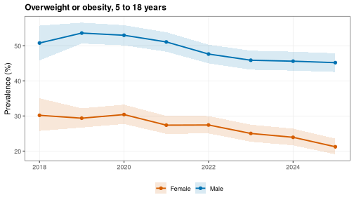
</div>

**What to look at.** The sex difference in overweight and obesity, the
differences between sites and the direction of the calendar trend.

## 2. Stunting, thinness, obesity and the double burden [2]

`wgh_flow_malnutrition_trends()` estimates four indicators by sex and year,
tests trends, fits GEE logistic models of calendar trends within age groups
and measures the double burden of malnutrition in children and in
populations.


```r
maln <- wgh_flow_malnutrition_trends(v)
maln
#> 
#> -- Stunting, thinness, obesity and double burden (Ho et al. 2026, medRxiv 2026.07.26.26358982) --
#> 
#> Tables (6): table1, prevalence_by_year, trend_tests, gee_odds_ratios, double_burden, median_by_site
#> Figures (4): fig_trends, fig_status_bars, fig_dbm_heatmap, fig_or_forest
#> Model status: 4 ok, 0 failed, 0 skipped
#> ok: GEE calendar trend, stunting (warning: Skipping age group(s) 10-14 y, 15-18 y with fewer than
#> 10 events. | Skipping age group(s) 5-9 y, 10-14 y with fewer than 10 events.)
#> Settings: mode = dev; n_children = 5664
head(maln$tables$gee_odds_ratios)
#> # A tibble: 6 x 12
#>   indicator sex    term       estimate     se   lower   upper p_value age_group or_per_year or_lower
#>   <chr>     <chr>  <chr>         <dbl>  <dbl>   <dbl>   <dbl>   <dbl> <chr>           <dbl>    <dbl>
#> 1 stunting  Male   age_group~  -0.0670 0.0511 -0.167   0.0332 1.90e-1 <5 y            0.935    0.846
#> 2 stunting  Male   age_group~   0.0477 0.0635 -0.0767  0.172  4.53e-1 5-9 y           1.05     0.926
#> 3 stunting  Female age_group~  -0.233  0.0584 -0.348  -0.119  6.40e-5 <5 y            0.792    0.706
#> 4 stunting  Female age_group~  -0.107  0.105  -0.314   0.0988 3.07e-1 15-18 y         0.898    0.731
#> 5 thinness  Male   age_group~  -0.0140 0.0366 -0.0859  0.0578 7.02e-1 <5 y            0.986    0.918
#> 6 thinness  Male   age_group~   0.0523 0.0448 -0.0355  0.140  2.43e-1 5-9 y           1.05     0.965
#> # i 1 more variable: or_upper <dbl>
```


```r
plot(maln, "fig_or_forest")
```

<div class="figure">
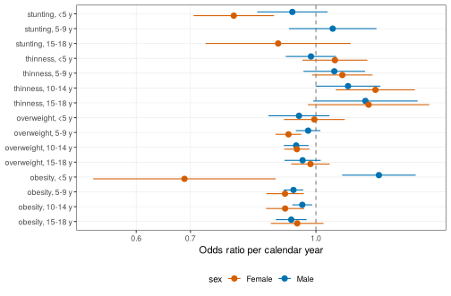
</div>

**What to look at.** Odds ratios below 1 mean an indicator becomes less
common each year. Age groups with too few cases are skipped and listed in
the model status.

## 3. Prepubertal BMI and the height trajectory [3]

`wgh_flow_index_trajectory()` assigns a BMI category at a prepubertal index
age, compares HAZ between categories at milestone ages, fits mixed models of
the HAZ trajectory and reports contrasts at stated ages.


```r
traj <- wgh_flow_index_trajectory(v)
traj
#> 
#> -- Prepubertal BMI and height trajectory (Ho et al. 2026, medRxiv 2026.07.26.26358003) --
#> 
#> Tables (9): index_category, kruskal_wallis, dunn, median_haz, fit_stats_male, fit_stats_female,
#> contrasts, bmi_change, sensitivity_4plus_visits
#> Figures (2): fig_trajectories, fig_height_trajectories
#> Models: Male, Female
#> Settings: mode = dev; index_age = 11/ 9
head(traj$tables$contrasts)
#> # A tibble: 6 x 10
#>   sex   contrast               age estimate     SE    df asymp.LCL asymp.UCL z.ratio  p.value
#>   <chr> <fct>                <dbl>    <dbl>  <dbl> <dbl>     <dbl>     <dbl>   <dbl>    <dbl>
#> 1 Male  Overweight - Normal      8   0.0841 0.0556   Inf  -0.0490      0.217    1.51 1.30e- 1
#> 2 Male  Obesity - Normal         8   0.232  0.0560   Inf   0.0977      0.366    4.14 1.05e- 4
#> 3 Male  Obesity - Overweight     8   0.148  0.0641   Inf  -0.00578     0.301    2.30 4.25e- 2
#> 4 Male  Overweight - Normal     10   0.184  0.0513   Inf   0.0616      0.307    3.59 6.52e- 4
#> 5 Male  Obesity - Normal        10   0.383  0.0517   Inf   0.260       0.507    7.42 3.57e-13
#> 6 Male  Obesity - Overweight    10   0.199  0.0591   Inf   0.0576      0.340    3.37 7.52e- 4
```


```r
plot(traj, "fig_trajectories")
```

<div class="figure">
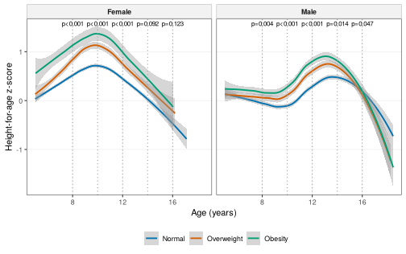
</div>

**What to look at.** The height advantage of children with obesity before
puberty, and how it shrinks or reverses in adolescence.

## 4. The pubertal growth spurt by SITAR [4]

`wgh_flow_pubertal_spurt()` fits SITAR models for boys and girls, checks
them, estimates the population APHV and PHV with intervals, extracts each
child's timing and intensity and relates them to prepubertal BMI and height.
Its report is reused by the next flows.


```r
spurt <- wgh_flow_pubertal_spurt(v)
#> SITAR fitted to a random 1000 of 1433 children (run mode "dev").
#> SITAR fitted to a random 1000 of 1203 children (run mode "dev").
spurt
#> 
#> -- Pubertal growth spurt by SITAR (Ho et al. 2026, medRxiv 2026.07.26.26358986) --
#> 
#> Tables (7): age_density, model_diagnostics, aphv_phv_population, individual_effects,
#> individual_summary, timing_models, early_timing_logistic
#> Figures (3): fig_velocity, fig_height, fig_aphv_by_bmi
#> Models: sitar_male, sitar_female
#> Diagnostics: identifiability
#> Settings: mode = dev; ci_B = 0
spurt$tables$aphv_phv_population
#> # A tibble: 2 x 10
#>   sex    method           aphv aphv_lower aphv_upper   phv phv_lower phv_upper n_children replicates
#>   <chr>  <chr>           <dbl>      <dbl>      <dbl> <dbl>     <dbl>     <dbl>      <int>      <int>
#> 1 Male   legacy (not a ~ 12.1       12.0       12.1  10.1      10.1      10.1        1000         NA
#> 2 Female legacy (not a ~  8.96       8.92       9.00  7.94      7.89      7.99       1000         NA
```


```r
plot(spurt, "fig_velocity")
```

<div class="figure">
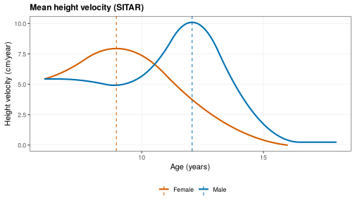
</div>

**What to look at.** Girls reach their peak years before boys. The
`early_timing_logistic` table shows how prepubertal BMI and height predict
early timing.

## 5. Predicting late-adolescent height [5]

`wgh_flow_height_prediction()` builds a cohort of prepubertal features and
late-adolescent height, compares nine models on the same folds and by site,
attaches prediction intervals, checks calibration and agreement, explains
the gradient boosting model with SHAP and shows a prediction for one child.


```r
pred <- wgh_flow_height_prediction(v, spurt = spurt)
#> Warning in predict.lm(m, te): prediction from rank-deficient fit; attr(*, "non-estim") has doubtful
#> cases
#> Warning: M6 explains more than 90% of the variance.
#> i SITAR b and c were estimated with visits from the outcome window, so part of this performance is
#>   leakage. Treat M6 as an upper bound.
pred
#> 
#> -- Late-adolescent height prediction (Ho 2026, manuscript under review) --
#> 
#> Tables (10): attrition, table1, cv_performance, apparent_performance, leave_one_site_out,
#> m5_vs_m7_bootstrap, m5_coefficients, prediction_intervals_m5, shap_importance_m7_boys,
#> example_prediction
#> Figures (6): fig_cv_rmse, fig_calibration_m5, fig_bland_altman_m5, fig_obs_pred_all,
#> fig_shap_beeswarm_m7_boys, fig_child_prediction
#> Models: benchmark, loso
#> Diagnostics: model_errors
#> Settings: mode = dev; cohort_n = 358
pred$tables$cv_performance[, c("sex", "model", "n", "RMSE", "R2")]
#> # A tibble: 18 x 5
#>    sex    model     n  RMSE     R2
#>    <chr>  <chr> <int> <dbl>  <dbl>
#>  1 Male   M0      147 3.57  0.294 
#>  2 Male   M1      147 2.60  0.625 
#>  3 Male   M2      147 2.33  0.699 
#>  4 Male   M3      147 2.53  0.645 
#>  5 Male   M4      147 2.49  0.655 
#>  6 Male   M5      147 2.50  0.654 
#>  7 Male   M6       96 0.950 0.951 
#>  8 Male   M7      147 2.60  0.626 
#>  9 Male   M8      147 2.73  0.588 
#> 10 Female M0      211 4.57  0.0812
#> # i 8 more rows
```


```r
plot(pred, "fig_child_prediction")
```

<div class="figure">
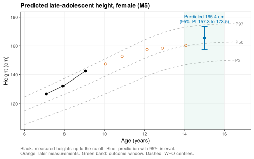
</div>

**What to look at.** Whether complex models beat the linear mixed model
(M5), the width and coverage of the prediction intervals, and that M6 is an
upper bound because SITAR timing uses outcome-window visits (the flow warns
about this).

## 6. BMI and the height-for-age distribution [6]

`wgh_flow_distributional_height()` fits quantile models of HAZ on BAZ with a
spline of age, by sex, reads BAZ slopes at stated ages with a child-level
bootstrap and tests whether slopes differ across quantiles and between the
sexes. `engine = "lqmm"` (default) uses linear quantile mixed models as in
the study, `"rq"` the faster pooled model used here.


```r
dist <- wgh_flow_distributional_height(v, engine = "rq")
dist
#> 
#> -- BMI and the height-for-age distribution (Ho 2026, medRxiv 2026.09.08.26362487) --
#> 
#> Tables (6): mean_model_slopes_male, mean_model_slopes_female, quantile_slopes, heterogeneity,
#> sex_difference, crossing
#> Figures (2): fig_coefficient_functions, fig_spread_by_bmi
#> Models: Male, Male_mean, Female, Female_mean
#> Model status: 14 ok, 0 failed, 1 skipped
#> skipped: qgam sensitivity analysis (sensitivity = FALSE)
#> Settings: mode = dev; engine = rq
head(dist$tables$quantile_slopes)
#> # A tibble: 6 x 7
#>   sex     age   tau estimate boot_se    lower  upper
#>   <chr> <dbl> <dbl>    <dbl>   <dbl>    <dbl>  <dbl>
#> 1 Male      6  0.1  -0.0247   0.0451 -0.0489  0.0681
#> 2 Male      9  0.1   0.0503   0.0349 -0.00655 0.0901
#> 3 Male     12  0.1   0.103    0.0431  0.0754  0.186 
#> 4 Male     15  0.1  -0.00523  0.0265 -0.0557  0.0305
#> 5 Male      6  0.25  0.0116   0.0285 -0.0338  0.0533
#> 6 Male      9  0.25  0.0513   0.0364  0.00652 0.108
```


```r
plot(dist, "fig_coefficient_functions")
```

<div class="figure">
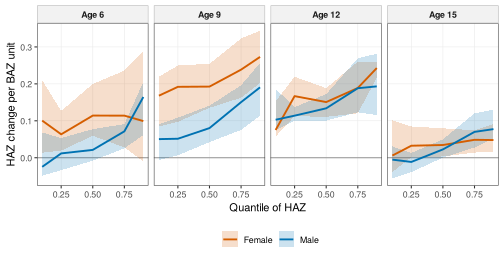
</div>

**What to look at.** Whether the BAZ slope differs between the lower and
upper quantiles, and how it changes from childhood to adolescence.

## 7. Prepubertal BMI and the distribution of pubertal velocity [7]

`wgh_flow_velocity_distribution()` relates prepubertal BMI to the whole
distribution of height velocity around puberty, and to each child's timing,
intensity and peak velocity, with quantile models and a mediation analysis
through timing.


```r
vel <- wgh_flow_velocity_distribution(v, spurt = spurt)
vel
#> 
#> -- Prepubertal BMI and the distribution of pubertal velocity (Ho 2026, medRxiv 2026.09.04.26362313) --
#> 
#> Tables (3): velocity_quantile_slopes, scalar_quantiles, mediation_timing
#> Figures (3): fig_velocity_aphv_male, fig_velocity_aphv_female, fig_velocity_slopes
#> Settings: mode = dev
vel$tables$mediation_timing
#> # A tibble: 8 x 5
#>   sex    effect                  estimate   lower    upper
#>   <chr>  <chr>                      <dbl>   <dbl>    <dbl>
#> 1 Male   Total effect              0.0714  0.0595  0.0877 
#> 2 Male   Natural direct effect    -0.0322 -0.0423 -0.00873
#> 3 Male   Natural indirect effect   0.104   0.0868  0.115  
#> 4 Male   Proportion mediated       1.45    1.11    1.59   
#> 5 Female Total effect              0.133   0.0971  0.174  
#> 6 Female Natural direct effect    -0.0107 -0.0191  0.0331 
#> 7 Female Natural indirect effect   0.144   0.111   0.176  
#> 8 Female Proportion mediated       1.08    0.805   1.18
```


```r
plot(vel, "fig_velocity_slopes")
```

<div class="figure">
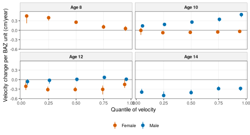
</div>

**What to look at.** Higher prepubertal BMI raises velocity before the
usual peak age and lowers it later, because it shifts the spurt earlier. The
mediation table shows how much of the BMI effect on peak velocity passes
through timing.

## 8. The duration of the pubertal spurt [8]

`wgh_flow_spurt_duration()` measures each child's spurt width on the spurt
amplitude, shows how often the older fraction-of-peak definition is
censored, and relates duration to prepubertal BMI with and without
adjustment for timing and intensity.


```r
dur <- wgh_flow_spurt_duration(v, spurt = spurt)
dur
#> 
#> -- Duration of the pubertal growth spurt (Ho 2026, medRxiv 2026.09.09.26362696) --
#> 
#> Tables (6): duration_features, censoring, fpca_variance, duration_ols, duration_quantile,
#> sex_interaction
#> Figures (1): fig_duration_by_bmi
#> Model status: 2 ok, 0 failed, 0 skipped
#> Settings: mode = dev
dur$tables$censoring
#> # A tibble: 4 x 4
#>   sex    definition               pct_left_censored median_width
#>   <chr>  <chr>                                <dbl>        <dbl>
#> 1 Male   amplitude (default)                      0         2.32
#> 2 Male   fraction of PHV (legacy)                 0         4.46
#> 3 Female amplitude (default)                      0         3.24
#> 4 Female fraction of PHV (legacy)               100        NA
dur$tables$duration_ols
#> # A tibble: 4 x 7
#>   sex    model                     term      estimate     lower     upper       p_value
#>   <chr>  <chr>                     <chr>        <dbl>     <dbl>     <dbl>         <dbl>
#> 1 Female unadjusted                baz_pre -0.0767    -0.101    -0.0522   0.00000000129
#> 2 Female adjusted_timing_intensity baz_pre -0.00162   -0.00555   0.00232  0.421        
#> 3 Male   unadjusted                baz_pre -0.0174    -0.0241   -0.0107   0.000000505  
#> 4 Male   adjusted_timing_intensity baz_pre  0.0000517 -0.000251  0.000354 0.738
```


```r
plot(dur, "fig_duration_by_bmi", alpha = 0.4)
```

<div class="figure">
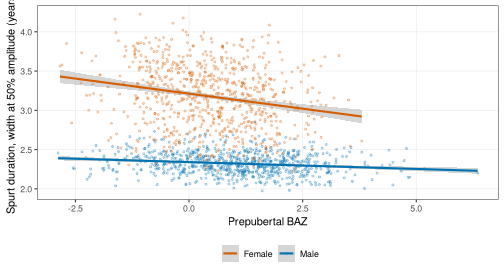
</div>

**What to look at.** The censoring table, and whether the BMI association
with duration remains after adjusting for timing and intensity.

## 9. Peri-pubertal growth phenotypes [9]

`wgh_flow_growth_phenotypes()` summarises trajectories with functional PCA,
adds SITAR timing and intensity, clusters children with Gaussian mixtures,
names the phenotypes, checks their stability and validity, and relates them
to late height-for-age.


```r
pheno <- wgh_flow_growth_phenotypes(v, spurt = spurt)
pheno
#> 
#> -- Growth phenotypes by functional clustering (Ho 2026, medRxiv 2026.09.05.26362315) --
#> 
#> Tables (5): centroids, stability, validation, late_haz_link, leakage_note
#> Figures (4): fig_bic_male, fig_phenotypes_male, fig_bic_female, fig_phenotypes_female
#> Models: Male, Female
#> Model status: 4 ok, 0 failed, 0 skipped
#> Settings: mode = dev; max_age = 18
pheno$tables$centroids
#> # A tibble: 9 x 8
#>   sex    cluster name               share      fpc1   fpc2       b       c
#>   <chr>    <dbl> <chr>              <dbl>     <dbl>  <dbl>   <dbl>   <dbl>
#> 1 Male         1 Average           0.578  -0.0440    0.178 -0.0885  0.0760
#> 2 Male         2 Late              0.0963 -0.498    -0.615  1.06   -0.123 
#> 3 Male         3 Average 1         0.0753  0.000581  0.721 -0.395   0.0238
#> 4 Male         4 Average 2         0.251   0.293    -0.391 -0.0861 -0.135 
#> 5 Female       1 Late, slow        0.301  -0.338    -0.966  0.865  -0.793 
#> 6 Female       2 Average           0.217  -0.261    -0.170 -0.483   0.223 
#> 7 Female       3 Tall, early, fast 0.205   0.807     0.981 -0.974   1.22  
#> 8 Female       4 Average 1         0.204  -0.135     0.484 -0.0520 -0.0210
#> 9 Female       5 Late, slow 1      0.0737  0.274     0.374  0.746  -0.748
pheno$tables$stability
#> # A tibble: 2 x 6
#>   sex        G model ari_median ari_lower ari_upper
#>   <chr>  <int> <chr>      <dbl>     <dbl>     <dbl>
#> 1 Male       4 EVV        0.567     0.195     0.754
#> 2 Female     5 VVV        0.420     0.178     0.548
```


```r
plot(pheno, "fig_phenotypes_female")
```

<div class="figure">
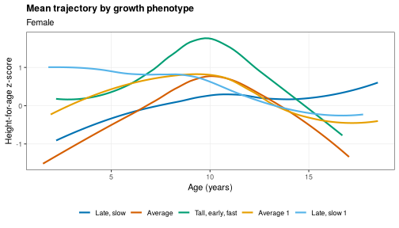
</div>

**What to look at.** Interpretable phenotypes (for example tall, early and
fast), their shares, and an adjusted Rand index well above zero.

## 10. Conditional growth references [10]

`wgh_flow_conditional_references()` predicts each child's later
height-for-age distribution from earlier growth, validates the references
against unconditional, persistence and WHO benchmarks by cross-validation
and by site, checks calibration, flags children outside their own expected
range and draws fan charts.


```r
cond <- wgh_flow_conditional_references(v, window = c(5, 9), targets = c(10, 12, 14))
cond
#> 
#> -- Conditional growth references (Ho 2026, medRxiv 2026.09.23.26363771) --
#> 
#> Tables (9): panel_size, table1, coefficients_median, cv_scores_by_fold, cv_scores,
#> leave_one_site_out, calibration, centiles, flags
#> Figures (4): fig_scores, fig_calibration, fig_fan_low, fig_fan_high
#> Models: condref
#> Settings: mode = dev; window = 5/9; targets = 10/12/14
aggregate(cbind(crps, coverage_90, width_90) ~ model, data = cond$tables$cv_scores, FUN = mean)
#>           model      crps coverage_90 width_90
#> 1   conditional 0.2135070   0.8860464 1.218909
#> 2   persistence 0.2373606   0.8921887 1.378867
#> 3 unconditional 0.4028554   0.8764118 2.366125
#> 4           who 0.5382017   0.9001946 3.289707
cond$tables$flags
#>      sex target_nominal below above
#> 1   Male             10   3.1   3.1
#> 2 Female             10   3.1   3.1
#> 3   Male             12   2.7   3.0
#> 4 Female             12   2.3   2.6
#> 5   Male             14   2.5   3.3
#> 6 Female             14   3.3   2.5
```


```r
plot(cond, "fig_fan_low")
```

<div class="figure">
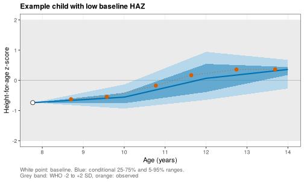
</div>

**What to look at.** The conditional reference has the lowest CRPS with
coverage near 90% and a much narrower range than the WHO band.

## 11. Canalization, catch-up and catch-down [11]

`wgh_flow_canalization()` puts visits into height-for-age bands, builds
transition matrices, summarises persistence, catch-up and catch-down by age,
fits a continuous-time multistate model and mixed models of catch-up and
catch-down.


```r
canal <- wgh_flow_canalization(v)
#> boundary (singular) fit: see help('isSingular')
#> boundary (singular) fit: see help('isSingular')
canal
#> 
#> -- Canalization, catch-up and catch-down (Ho 2026, manuscript under review) --
#> 
#> Tables (10): bands, transition_matrix, canalization, msm_intensity_check, msm_pmatrix_1y,
#> msm_sojourn, msm_hazard_ratios, msm_prevalence, glmm_catch_up, glmm_catch_down
#> Figures (2): fig_transition_heatmap, fig_prevalence_check
#> Models: msm, glmm_up, glmm_down
#> Settings: mode = dev
canal$tables$canalization
#> # A tibble: 6 x 7
#>   sex    age_block transitions persistence catch_up catch_down toward_median
#>   <chr>  <chr>           <int>       <dbl>    <dbl>      <dbl>         <dbl>
#> 1 Male   [5,9)            2808        87.9    15.5       20.0           18.1
#> 2 Female [5,9)            2671        74.5    69.7        4.59          14.4
#> 3 Male   [9,13)           2141        73.3    45.3        8.10          20.4
#> 4 Female [9,13)           2099        74.5    18.4       34.4           33.8
#> 5 Male   [13,19)          1597        70.3     4.17      68.6           50.7
#> 6 Female [13,19)          1418        88.9     4.97      22.9           10.5
```


```r
plot(canal, "fig_transition_heatmap")
```

<div class="figure">
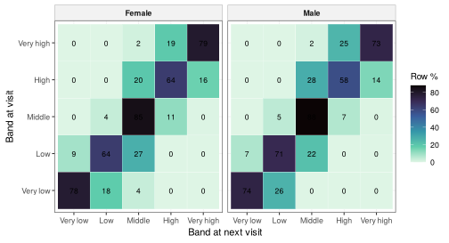
</div>

**What to look at.** High persistence on the diagonal, moves mostly to
adjacent bands, and the warning that part of every move is measurement
error. `wgh_false_moves()` estimates how large that part is:


```r
wgh_false_moves(v, error_sds = c(0.5, 1))
#> No error-free height in the data. The recorded height is used as the reference, so the shares are
#> lower bounds.
#> # A tibble: 2 x 6
#>   error_sd_cm n_transitions persistence_pct observed_moves_pct false_moves_pct missed_moves_pct
#>         <dbl>         <int>           <dbl>              <dbl>           <dbl>            <dbl>
#> 1         0.5         16805            76.6               23.4            29.7             22.5
#> 2         1           16805            71.5               28.5            50.1             33.0
```

## 12. Growth inequality over age and BMI [12]

`wgh_flow_growth_inequality()` reads the spread of the height-for-age
distribution (the 5th to 95th centile range and the interquartile range) at
each age and BAZ, with bootstrap intervals, and flags combinations with
little data.


```r
ineq <- wgh_flow_growth_inequality(v)
ineq
#> 
#> -- Growth inequality: spread of height by BMI (Ho 2026, manuscript under review) --
#> 
#> Tables (5): spread, change_per_baz, support, sample_size, empirical_check
#> Figures (2): fig_range90, fig_iqr
#> Models: Male, Female
#> Settings: mode = dev
ineq$tables$change_per_baz
#> # A tibble: 8 x 8
#>   sex      age range90_per_unit iqr_per_unit range90_lower range90_upper iqr_lower iqr_upper
#>   <chr>  <dbl>            <dbl>        <dbl>         <dbl>         <dbl>     <dbl>     <dbl>
#> 1 Male       6           0.154        0.0500       0.0866          0.274   0.0314     0.0790
#> 2 Male       9           0.170        0.0835       0.107           0.203   0.0203     0.120 
#> 3 Male      12           0.142        0.0906       0.0772          0.208   0.0481     0.117 
#> 4 Male      15           0.0806       0.0857       0.0444          0.124   0.0351     0.105 
#> 5 Female     6           0.152        0.0700       0.00828         0.296   0.0462     0.129 
#> 6 Female     9           0.181        0.0588       0.147           0.245  -0.00272    0.0928
#> 7 Female    12           0.172        0.0271       0.102           0.259  -0.0232     0.0824
#> 8 Female    15           0.136        0.0282       0.0989          0.227  -0.0421     0.0750
```


```r
plot(ineq, "fig_range90")
```

<div class="figure">
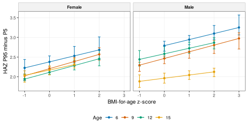
</div>

**What to look at.** Whether the spread widens or narrows as BAZ rises, and
at which ages.

## 13. Growth phenotypes and later outcomes, growth side [13]

`wgh_flow_phenotype_outcomes()` links the phenotypes of flow 9 to a later
outcome with bootstrap intervals and a dose-response model on timing. By
default the outcome is overweight or obesity at 15 years or older. Pass your
own outcome table as `outcome_data`.


```r
outc <- wgh_flow_phenotype_outcomes(v, phenotypes = pheno)
#> Warning: Fewer than 5 outcome events in phenotype(s) Average, Late, slow 1: estimates are unstable.
outc
#> 
#> -- Growth phenotypes and later outcomes, growth side (Ho 2026, manuscript in preparation) --
#> 
#> Tables (4): representativeness, phenotype_outcome, dose_response_timing, mediation
#> Figures (1): fig_forest
#> Settings: mode = dev; outcome = late_overweight_obesity
outc$tables$phenotype_outcome
#> # A tibble: 7 x 8
#>   sex    term                       estimate   lower   upper odds_ratio    or_lower or_upper
#>   <chr>  <chr>                         <dbl>   <dbl>   <dbl>      <dbl>       <dbl>    <dbl>
#> 1 Male   phenotypeAverage            -0.625   -1.41  -0.139       0.535 0.245          0.870
#> 2 Male   phenotypeLate               -0.822  -14.4   -0.165       0.440 0.000000547    0.848
#> 3 Male   phenotypeAverage 1           0.581   -0.298  0.745       1.79  0.742          2.11 
#> 4 Female phenotypeLate, slow         -0.372   -0.801 -0.0286      0.689 0.449          0.972
#> 5 Female phenotypeAverage            -0.0145  -1.10   0.895       0.986 0.333          2.45 
#> 6 Female phenotypeTall, early, fast   1.73     1.21   3.39        5.65  3.35          29.8  
#> 7 Female phenotypeLate, slow 1       -0.829  -15.5    0.614       0.436 0.000000188    1.85
```


```r
plot(outc, "fig_forest")
```

<div class="figure">
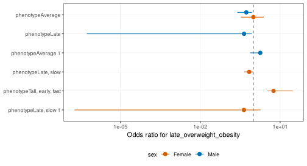
</div>

**What to look at.** Which phenotypes carry higher odds of the later
outcome, and the warnings for phenotypes with few events.

## 14. Explainable individual growth prediction [14]

`wgh_flow_explain_prediction()` explains the conditional reference models
with exact SHAP values at the median and outer quantiles, compares them with
permutation importance and checks that feature rankings are stable across
folds.


```r
expl <- wgh_flow_explain_prediction(v, window = c(5, 9), targets = c(10, 12))
expl
#> 
#> -- Explainable individual growth prediction (Ho 2026, manuscript under review) --
#> 
#> Tables (4): importance, permutation, rank_stability, interaction
#> Figures (3): fig_waterfall_example, fig_beeswarm_example, fig_quantile_resolved
#> Settings: mode = dev; taus = 0.1/0.5/0.9
expl$tables$rank_stability
#> # A tibble: 4 x 5
#>   sex    target scheme  mean_spearman top_feature 
#>   <chr>   <dbl> <chr>           <dbl> <chr>       
#> 1 Male       10 5 folds             1 baseline_haz
#> 2 Male       12 5 folds             1 baseline_haz
#> 3 Female     10 5 folds             1 baseline_haz
#> 4 Female     12 5 folds             1 baseline_haz
```


```r
plot(expl, "fig_quantile_resolved")
```

<div class="figure">
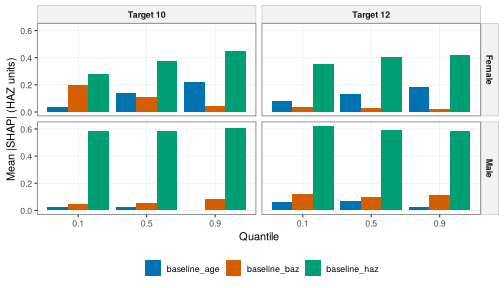
</div>

**What to look at.** Baseline height-for-age dominates every quantile, and
the rankings are stable (mean Spearman correlation near 1).

## Chaining and pipelines

The SITAR models of the pubertal spurt study are reused by flows 5, 7, 8
and 9, and the phenotypes by flow 13, as above. `wgh_use_pipeline()` writes
a `targets` pipeline that chains all the flows in this order and caches each
step:


```r
wgh_use_pipeline("my_project", data_file = "visits.rds", mode = "publication")
targets::tar_make()
```

For long runs, start parallel workers first with `wgh_parallel()` (see
`vignette("parallel-computing")`).

## Using your own data


```r
gd <- wgh_data(mydata, id = "child_id", sex = "sex", dob = "birth_date", date = "visit_date",
               height = "height_cm", weight = "weight_kg", site = "school")
wgh_config("publication")
rep <- wgh_flow_secular_trends(gd)
wgh_export(rep, "secular_trends")
```

## Corrected methods and legacy options

Reviewing the original analysis code found a few errors. The package uses
the corrected method by default and keeps an option that reproduces the
original output:

| Default (corrected) | Legacy option | What changed |
|---|---|---|
| `wgh_sitar_ci(method = "bootstrap")` | `method = "legacy"` | APHV and PHV intervals come from a bootstrap over children |
| `wgh_sitar_effects()` | `legacy_c_labels = TRUE` | Positive SITAR intensity `c` means a faster spurt |
| Exact individual APHV | none | Exact SITAR formula instead of APHV plus `b` |
| `wgh_curve_features(reference = "takeoff")` | `reference = "zero"` | Duration measured on the spurt amplitude |
| `wgh_zscore(method = "who")` | `method = "lms"` or `"symmetric"` | WHO restricted tails for weight and BMI |
| `wgh_benchmark(site_effect = "fixed")` | `site_effect = "random"` | Site as a fixed effect in the model ladder |
| `wgh_leakage_check()` | none | Features from outcome-window visits are flagged |

`wgh_compare_outputs()` compares a report's tables with frozen tables from
the original code, column by column.

## Citing

Please cite the package (`citation("WeGrowHealthR")`) and the studies whose
analyses you reproduce.

## References

1. Ho NT, Bangsberg D, Hermiston ML, et al. Overweight and obesity epidemic, temporal trends and regional disparities in physical growth of Vietnamese children. Scientific Reports. 2026;16:7515. https://doi.org/10.1038/s41598-026-37210-w

2. Ho NT, Hermiston M, Nguyen MA, Nguyen QV, Dao AQ, Tran CTL, Le HTM, Pham TV, Phung LT, Nguyen HT, Nguyen QN, Phung LN, Do CT, Pham AN. Stunting, thinness, obesity, and double burden of malnutrition in Vietnamese urban children. medRxiv. 2026. 2026.07.26.26358982. https://doi.org/10.64898/2026.07.26.26358982

3. Ho NT, Hermiston M, Nguyen QT, Nguyen MA, Nguyen QV, Dao AQ, Tran CTL, Nguyen QN, Phung LN, Do CT, Pham AN. Effect of pre-pubertal body mass index status on longitudinal height trajectory in Vietnamese children: 2018-2025 school health analysis. medRxiv. 2026. 2026.07.26.26358003. https://doi.org/10.64898/2026.07.26.26358003

4. Ho NT, Nguyen QV, Dao AQ, Tran CTL, Pham AN. Pubertal growth spurt characteristics of Vietnamese urban schoolchildren: population and individual level analysis using SITAR. medRxiv. 2026. 2026.07.26.26358986. https://doi.org/10.64898/2026.07.26.26358986

5. Ho NT. Predicting late-adolescent height from prepubertal growth trajectories in Vietnamese schoolchildren. Manuscript under review. 2026.

6. Ho NT. The age-varying association between BMI and height-for-age in Vietnamese schoolchildren: a sex-stratified quantile regression study. medRxiv. 2026. 2026.09.08.26362487. https://doi.org/10.64898/2026.09.08.26362487

7. Ho NT. Prepubertal body mass index reshapes the distribution of pubertal growth velocity in Vietnamese children: a SITAR-based quantile analysis. medRxiv. 2026. 2026.09.04.26362313. https://doi.org/10.64898/2026.09.04.26362313

8. Ho NT. Body mass index and the duration of the pubertal growth spurt in Vietnamese urban children. medRxiv. 2026. 2026.09.09.26362696. https://doi.org/10.64898/2026.09.09.26362696

9. Ho NT. Distinct peri-pubertal growth phenotypes among Vietnamese urban children: a functional clustering analysis of 2018-2025 school health data. medRxiv. 2026. 2026.09.05.26362315. https://doi.org/10.64898/2026.09.05.26362315

10. Ho NT. Conditional growth references for Vietnamese children: quantile regression of growth distributions and phenotypes. medRxiv. 2026. 2026.09.23.26363771. https://doi.org/10.64898/2026.09.23.26363771

11. Ho NT. Height trajectory canalization, catch-up, and catch-down growth in urban Vietnamese children. Manuscript under review. 2026.

12. Ho NT. Growth inequality over age and BMI in Vietnamese children: age-varying dispersion of the conditional height-for-age distribution from quantile regression. Manuscript under review. 2026.

13. Ho NT. Peri-pubertal growth phenotypes and later health in Vietnamese schoolchildren. Manuscript in preparation. 2026.

14. Ho NT. Explainable individualized growth prediction: interpreting conditional height-for-age predictions across the growth distribution. Manuscript under review. 2026.
